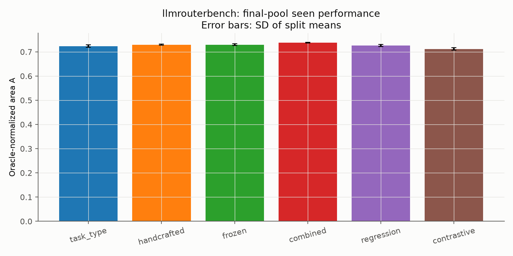
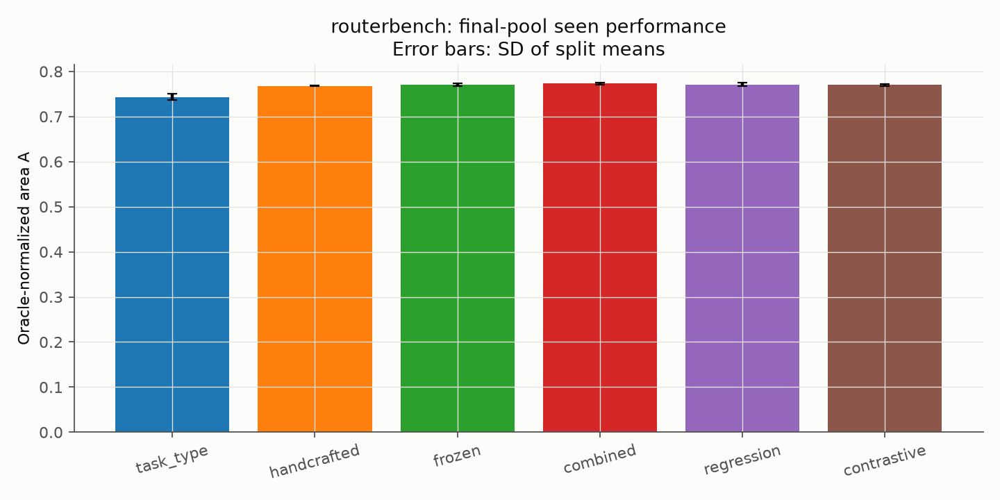
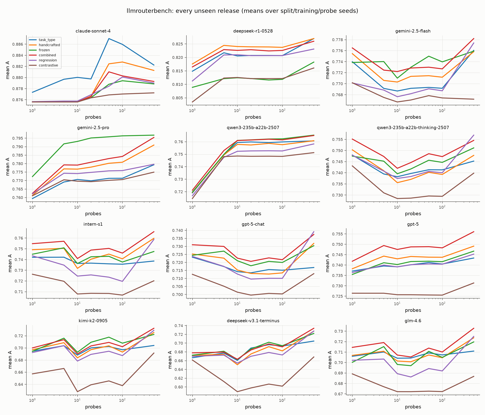
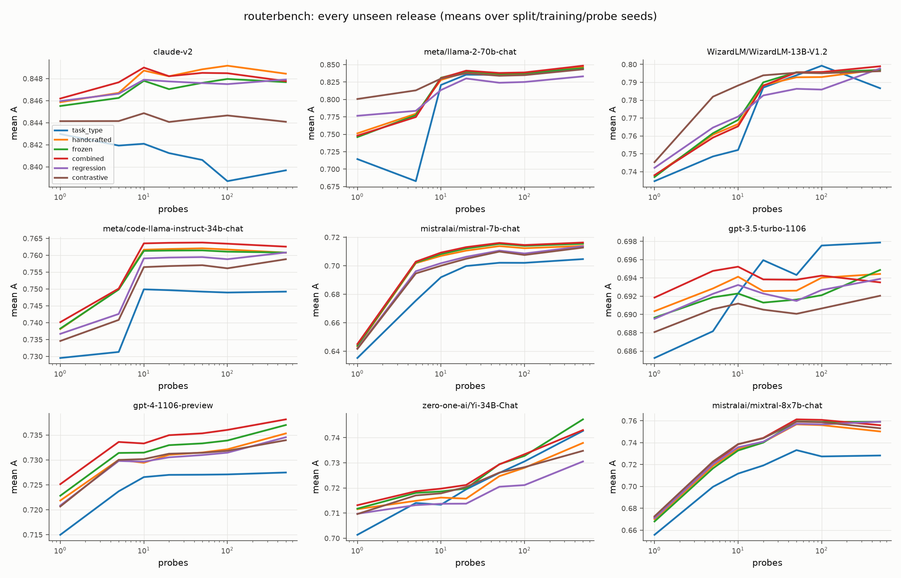
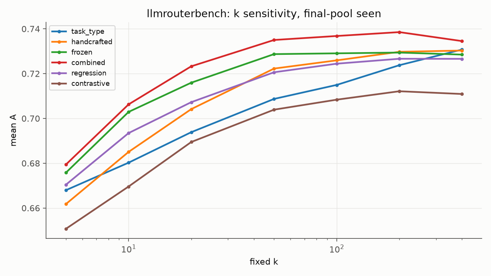
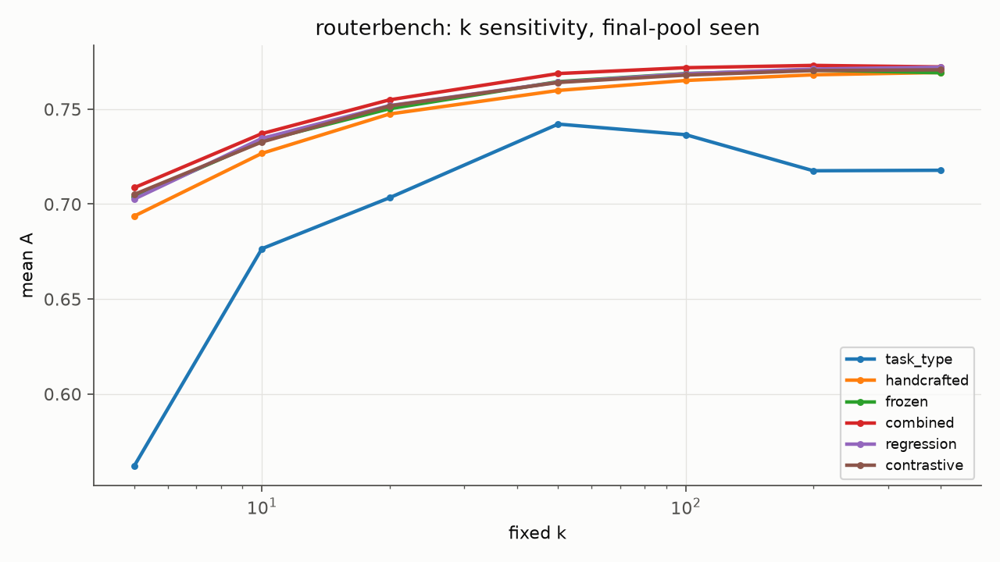

# Query representation learning: completed experiments

The agreed project implementation and the three selected remaining tasks are complete. The full experiment grid, k/lambda sensitivity checks, and all requested split/training/probe repeats were executed and checked for missing or duplicate experiment keys.

## What is implemented

- Data preprocessing, release timelines, shared query splits and nested probe sampling.
- Handcrafted features; frozen sentence embeddings; their concatenation; and an MLP learned with either profile regression or contrastive learning. Task-type-only is included for RQ1a.
- The shared kNN quality estimator and quality-minus-cost routing rule, validation-based k selection, single-best and oracle comparisons, cost-quality area A, gain and paired-bootstrap intervals.
- Seen and unseen-model experiments, task-type recovery, and proposal-defined probes-to-target.
- Complete-grid execution with resumable results, cached fits/neighbor estimates, and reference-tested transition-based evaluation. These execution changes preserve the original routing and metric definitions.

## Completed coverage

| Item | Completed |
|---|---|
| Benchmarks | LLMRouterBench and RouterBench |
| Release instances | All 12 primary and 9 secondary instances |
| Split seeds | [0, 1, 2] |
| Learned-model training seeds | [0, 1, 2] |
| Probe seeds | [0, 1, 2] |
| Probe budgets | [1, 5, 10, 20, 50, 100, 500] |
| Representations | All six entries, covering the four proposal types and both learned objectives |
| Main evaluation rows | 25,056 / 25,056 |
| Sensitivity rows | 300,672 / 300,672 |
| Missing or duplicate keys | 0 |
| Trained checkpoints | 486 distinct fits |
| Audited seen/unseen training roles | 792; zero held-out/split violations |
| Bootstrap samples | 1,000 per main evaluation; 200 for validation k selection |

Deterministic baselines have no trainable parameters, so their results are reused across training-seed labels rather than treating duplicate computations as independent evidence. Learned fits are separate for each split, training seed and permitted model pool; identical pools reuse the same checkpoint. Every unseen embedding excludes the newly released model's scores. Probe labels only enter its kNN estimate. The reserved validation split is used for k selection; embedding early stopping uses training queries only.

The primary processed data contains 12,066 queries × 13 models; the secondary contains 36,478 × 11. Timeline replay changes model availability; it does not simulate timestamped queries, silent API updates or historical price changes.

## Main metrics

A is cost-quality area divided by oracle area. Gain is relative area gain over the full-information single-best baseline; it is not percentage-point accuracy improvement. The cost axis is logarithmic. In the unseen setting, gain_same_probes also compares against a single-best baseline with the same probe labels.

### Final-pool seen results

Means over all three splits and three training seeds. Split SD is computed on split means; training SD is computed within each split and then averaged across splits.

**llmrouterbench**

| Representation | Mean A | Split SD | Training SD | Mean gain |
|---|---|---|---|---|
| combined | 0.7385 | 0.0015 | 0.0000 | +6.18% |
| contrastive | 0.7121 | 0.0049 | 0.0032 | +2.38% |
| frozen | 0.7294 | 0.0037 | 0.0000 | +4.86% |
| handcrafted | 0.7297 | 0.0020 | 0.0000 | +4.91% |
| regression | 0.7266 | 0.0046 | 0.0037 | +4.47% |
| task_type | 0.7238 | 0.0051 | 0.0000 | +4.05% |

Highest observed mean A among the original six entries: **combined** (0.7385). `combined` is the unweighted concatenation; this is not a claim that its block scaling is optimal.



**routerbench**

| Representation | Mean A | Split SD | Training SD | Mean gain |
|---|---|---|---|---|
| combined | 0.7731 | 0.0028 | 0.0000 | +7.98% |
| contrastive | 0.7703 | 0.0024 | 0.0019 | +7.60% |
| frozen | 0.7706 | 0.0037 | 0.0000 | +7.64% |
| handcrafted | 0.7681 | 0.0008 | 0.0000 | +7.29% |
| regression | 0.7711 | 0.0034 | 0.0009 | +7.71% |
| task_type | 0.7433 | 0.0069 | 0.0000 | +3.83% |

Highest observed mean A among the original six entries: **combined** (0.7731). `combined` is the unweighted concatenation; this is not a claim that its block scaling is optimal.



### Every unseen release at 500 probes

Each cell is mean A over split/training/probe seeds. Compare representations within a row: different release pools have different cost ranges and oracle normalizers. The CSVs also contain every smaller probe budget, gains, same-probe gains and bootstrap intervals. **Single-incumbent unseen pools use fixed k=10** (LLMRouterBench instance 0); other pools use validation-selected k. The same k estimates both incumbent and new-model quality, capped by the available labels/probe budget.

**llmrouterbench**

| instance | new_model | combined | contrastive | frozen | handcrafted | regression | task_type |
|---|---|---|---|---|---|---|---|
| 0 | claude-sonnet-4 | 0.8793 | 0.8772 | 0.8788 | 0.8813 | 0.8790 | 0.8822 |
| 1 | deepseek-r1-0528 | 0.8260 | 0.8161 | 0.8183 | 0.8270 | 0.8231 | 0.8270 |
| 2 | gemini-2.5-flash | 0.7782 | 0.7672 | 0.7759 | 0.7758 | 0.7774 | 0.7761 |
| 3 | gemini-2.5-pro | 0.7954 | 0.7750 | 0.7968 | 0.7909 | 0.7796 | 0.7793 |
| 4 | qwen3-235b-a22b-2507 | 0.7650 | 0.7513 | 0.7653 | 0.7608 | 0.7582 | 0.7607 |
| 5 | qwen3-235b-a22b-thinking-2507 | 0.7546 | 0.7398 | 0.7512 | 0.7478 | 0.7569 | 0.7453 |
| 6 | intern-s1 | 0.7659 | 0.7202 | 0.7475 | 0.7598 | 0.7587 | 0.7386 |
| 7 | gpt-5-chat | 0.7374 | 0.7130 | 0.7304 | 0.7319 | 0.7392 | 0.7168 |
| 8 | gpt-5 | 0.7561 | 0.7314 | 0.7467 | 0.7491 | 0.7453 | 0.7434 |
| 9 | kimi-k2-0905 | 0.7324 | 0.6915 | 0.7222 | 0.7254 | 0.7290 | 0.7040 |
| 10 | deepseek-v3.1-terminus | 0.7339 | 0.6684 | 0.7221 | 0.7274 | 0.7275 | 0.7047 |
| 11 | glm-4.6 | 0.7328 | 0.6868 | 0.7198 | 0.7237 | 0.7250 | 0.7110 |



**routerbench**

| instance | new_model | combined | contrastive | frozen | handcrafted | regression | task_type |
|---|---|---|---|---|---|---|---|
| 0 | claude-v2 | 0.8478 | 0.8441 | 0.8477 | 0.8484 | 0.8479 | 0.8397 |
| 1 | meta/llama-2-70b-chat | 0.8484 | 0.8433 | 0.8449 | 0.8466 | 0.8332 | 0.8438 |
| 2 | WizardLM/WizardLM-13B-V1.2 | 0.7990 | 0.7962 | 0.7969 | 0.7972 | 0.7977 | 0.7867 |
| 3 | meta/code-llama-instruct-34b-chat | 0.7626 | 0.7588 | 0.7608 | 0.7608 | 0.7608 | 0.7492 |
| 4 | mistralai/mistral-7b-chat | 0.7163 | 0.7128 | 0.7155 | 0.7139 | 0.7137 | 0.7047 |
| 5 | gpt-3.5-turbo-1106 | 0.6935 | 0.6920 | 0.6949 | 0.6944 | 0.6939 | 0.6979 |
| 6 | gpt-4-1106-preview | 0.7381 | 0.7340 | 0.7370 | 0.7353 | 0.7346 | 0.7275 |
| 7 | zero-one-ai/Yi-34B-Chat | 0.7430 | 0.7348 | 0.7473 | 0.7379 | 0.7305 | 0.7427 |
| 8 | mistralai/mixtral-8x7b-chat | 0.7560 | 0.7532 | 0.7590 | 0.7503 | 0.7592 | 0.7283 |



### Concatenation scaling: original versus balanced

`combined` means the original concatenation `[e(q), h(q)]`: a unit-norm sentence vector and train-standardized handcrafted features. Standardizing individual columns does not balance these blocks. Theme features can dominate Euclidean distance, favoring same-theme neighbors. The original tables and figures above refer to this unweighted version.

`combined_balanced` uses `[e(q), alpha * h(q)]`, where `alpha = sqrt(mean_train(||e||²) / mean_train(||h||²))`. This fits one scalar using training queries only and gives the blocks equal average squared norms on train. It preserves within-block geometry; it does not force equal norms for each query or guarantee equal distance contributions for every pair. No test labels select the weight.

Both versions were evaluated on identical main and sensitivity grids. The additional balanced run has **4,176 main rows** and **50,112 sensitivity rows**, with zero missing or duplicate keys. Original results were not overwritten. As with other deterministic baselines, training-seed labels reuse identical results.

Final-pool seen comparison (means over the same three splits and training-seed labels):

| benchmark | embedding | A_mean | A_split_sd | gain_mean |
|---|---|---|---|---|
| llmrouterbench | combined | 0.7385 | 0.0015 | 0.0618 |
| llmrouterbench | combined_balanced | 0.7372 | 0.0022 | 0.0599 |
| routerbench | combined | 0.7731 | 0.0028 | 0.0798 |
| routerbench | combined_balanced | 0.7746 | 0.0024 | 0.0819 |

Balancing slightly lowers mean A on LLMRouterBench and raises it on RouterBench. These are descriptive differences; neither scaling is established as the best concatenation, and no significance claim is made.

Every unseen release at 500 probes, using the same k-selection/fixed-k=10 policy stated above:

**llmrouterbench**

| instance | new_model | combined | combined_balanced |
|---|---|---|---|
| 0 | claude-sonnet-4 | 0.8793 | 0.8796 |
| 1 | deepseek-r1-0528 | 0.8260 | 0.8266 |
| 2 | gemini-2.5-flash | 0.7782 | 0.7792 |
| 3 | gemini-2.5-pro | 0.7954 | 0.7916 |
| 4 | qwen3-235b-a22b-2507 | 0.7650 | 0.7643 |
| 5 | qwen3-235b-a22b-thinking-2507 | 0.7546 | 0.7536 |
| 6 | intern-s1 | 0.7659 | 0.7547 |
| 7 | gpt-5-chat | 0.7374 | 0.7327 |
| 8 | gpt-5 | 0.7561 | 0.7534 |
| 9 | kimi-k2-0905 | 0.7324 | 0.7216 |
| 10 | deepseek-v3.1-terminus | 0.7339 | 0.7239 |
| 11 | glm-4.6 | 0.7328 | 0.7234 |

**routerbench**

| instance | new_model | combined | combined_balanced |
|---|---|---|---|
| 0 | claude-v2 | 0.8478 | 0.8478 |
| 1 | meta/llama-2-70b-chat | 0.8484 | 0.8479 |
| 2 | WizardLM/WizardLM-13B-V1.2 | 0.7990 | 0.7982 |
| 3 | meta/code-llama-instruct-34b-chat | 0.7626 | 0.7627 |
| 4 | mistralai/mistral-7b-chat | 0.7163 | 0.7165 |
| 5 | gpt-3.5-turbo-1106 | 0.6935 | 0.6948 |
| 6 | gpt-4-1106-preview | 0.7381 | 0.7386 |
| 7 | zero-one-ai/Yi-34B-Chat | 0.7430 | 0.7464 |
| 8 | mistralai/mixtral-8x7b-chat | 0.7560 | 0.7578 |

[Block scaling audit](results_summary/balanced/block_scaling.csv), [balanced metrics](results_summary/balanced/metrics.csv), [balanced protocol](results_summary/balanced/protocol.json), [balanced coverage](results_summary/balanced/coverage.json), [seen comparison](results_summary/balanced/comparison_seen.csv), [all-budget unseen comparison](results_summary/balanced/comparison_unseen.csv).

### Seed variability

`seen_summary.csv` and `unseen_summary.csv` separate split SD, within-split training SD and within-split/training probe SD. These measure different sources of variation and are not added together or presented as independent test-set confidence intervals. Per-run 95% paired test-query bootstrap intervals are retained in `metrics.csv`.

### Task-type recovery (RQ1a)

The ratio is A_task / A_learned for the same pool, setting, split and seeds. It can exceed one when task type performs better than the learned embedding. Final-pool seen means:

| Benchmark | Learned objective | Mean task-type recovery |
|---|---|---|
| llmrouterbench | contrastive | 1.0164 |
| llmrouterbench | regression | 0.9961 |
| routerbench | contrastive | 0.9649 |
| routerbench | regression | 0.9639 |

### Probes-to-target

Following the proposal, target = 90% of the matched seen-model A. Report the smallest **tested** probe budget meeting that target, separately for every release/split/training/probe combination.

Of 3,402 target measurements, 3,402 reached the target and 0 did not reach it by the largest tested budget. 2,971 reached it at one probe. This does not imply optimal routing from one probe: a high baseline A can make 90% of seen A easy to reach.

## k and lambda sensitivity

The original main settings were held fixed: k selected from [5, 10, 20, 50, 100, 200] using validation data and the one-standard-error rule; lambda = 0 plus 500 log-spaced values with lambda × cost-range spanning 10^-3 to 10^3. A single incumbent uses fixed k=10 because routing cannot select k in a one-candidate pool.

The following one-factor variants were evaluated for **every main evaluation key**, including every release, probe budget and seed:

- Fixed k: 5, 10, 20, 50, 100, 200, 400; retain the main lambda grid.
- Lambda-grid density: 100 and 1,000 points, alongside the 500-point reference.
- Lambda range: 10^-4 to 10^4 (wide) and 10^-2 to 10^2 (narrow), each with 500 points plus zero.

Sensitivity rows report point metrics; the 1,000-bootstrap intervals belong to the main evaluations. Sensitivity results were not used to retune the models or select hyperparameters on test queries.

Maximum and 95th-percentile absolute change in A below are paired differences from the matching main run, not averages of A levels across different release pools.

**llmrouterbench**

| variant | runs | max_abs_delta_A | p95_abs_delta_A |
|---|---|---|---|
| k10 | 14310 | 0.0926 | 0.0423 |
| k100 | 14310 | 0.0724 | 0.0100 |
| k20 | 14310 | 0.1442 | 0.0287 |
| k200 | 14310 | 0.0174 | 0.0008 |
| k400 | 14310 | 0.0764 | 0.0134 |
| k5 | 14310 | 0.1228 | 0.0617 |
| k50 | 14310 | 0.0941 | 0.0189 |
| lambda_points100 | 14310 | 0.0107 | 0.0015 |
| lambda_points1000 | 14310 | 0.0708 | 0.0005 |
| lambda_range_narrow | 14310 | 0.0141 | 0.0011 |
| lambda_range_wide | 14310 | 0.0044 | 0.0006 |



**routerbench**

| variant | runs | max_abs_delta_A | p95_abs_delta_A |
|---|---|---|---|
| k10 | 10746 | 0.3235 | 0.0822 |
| k100 | 10746 | 0.3121 | 0.0157 |
| k20 | 10746 | 0.3234 | 0.0633 |
| k200 | 10746 | 0.0347 | 0.0000 |
| k400 | 10746 | 0.1817 | 0.0095 |
| k5 | 10746 | 0.3122 | 0.1569 |
| k50 | 10746 | 0.3120 | 0.0610 |
| lambda_points100 | 10746 | 0.0085 | 0.0005 |
| lambda_points1000 | 10746 | 0.0021 | 0.0001 |
| lambda_range_narrow | 10746 | 0.0110 | 0.0020 |
| lambda_range_wide | 10746 | 0.0026 | 0.0001 |



**Interpretation:** k can materially change routing performance. Lambda-grid changes are usually smaller, but the maxima show that numerical stability cannot be assumed in every case. For example, the original, unmodified harness reproduced the task-type-only LLMRouterBench instance-10 unseen result (split 0, 10 probes, probe seed 1, k=200): A=0.5713 with 500 lambda points and A=0.6421 with 1,000. A coarse lambda sweep can miss useful cost-quality operating points. We retain the original main settings and report this sensitivity rather than choosing the test-favorable grid.

[Original-harness check for this example](results_summary/lambda_outlier_reference_check.json)

## Validation

`python -m pytest -q preproc michal-harness learned`: **91 passed, 1 skipped**.

**`michal-harness/router.py` is the reference implementation** for routing, area and paired-bootstrap metrics. The complete-grid accelerator must agree with it. Tests compare accelerated curves, areas, bootstrap intervals and validation-selected k to the reference. An offline integration test uses real `load_data('llmrouterbench', split_seed=0)` queries, scores and splits with handcrafted features: seen, unseen at 20 and 500 probes, and the single-incumbent k=10 case. It checks both neighbor/probe predictions and end-to-end A, gain and interval (absolute tolerance 1e-10). No encoder download is required. Tests also cover tied neighbors, exclusion of held-out model scores and external validation/test labels from training, checkpoint reloads, full-grid coverage and resumption. The coverage check requires every expected experiment key and rejects duplicates or non-finite metrics.

## Reproduce and inspect

From the repository root, activate the environment described in [setup instructions](learned/README.md), then:

```bash
python -m learned.full_experiments --output results/learned/full --workers 3 --threads 2

python -m learned.full_experiments --output results/learned/balanced --representations combined_balanced --workers 3 --threads 2

python -m learned.report --results results/learned/full --balanced results/learned/balanced
```

The full runner resumes completed shards and rejects an output directory with a different protocol. `coverage.json` verifies exact key coverage, not just total row counts. `protocol.json` stores the grid, bootstrap count, training configuration and sensitivity definitions. **The tracked `results_summary/` folder contains the reviewable results**, including the five requested files, both scaling variants, figures, audits and SHA-256 file manifests. `summary.csv` uses a two-row pandas column header (read with `header=[0, 1]`); its SD pools seed labels descriptively. Prefer `seen_summary.csv` and `unseen_summary.csv` for separate split/train/probe variability. `sensitivity.csv.gz` contains every sensitivity row, readable directly with pandas. Checkpoints and prediction caches remain gitignored.

- [Protocol](results_summary/protocol.json)
- [Main per-run metrics](results_summary/metrics.csv)
- [Summary](results_summary/summary.csv)
- [Seen seed summary](results_summary/seen_summary.csv)
- [Unseen seed summary](results_summary/unseen_summary.csv)
- [Probes-to-target](results_summary/probes_to_target.csv)
- [Sensitivity measurements (gzip)](results_summary/sensitivity.csv.gz)
- [Sensitivity summary](results_summary/sensitivity_summary.csv)
- [Coverage verification](results_summary/coverage.json)

- [Training-input audit](results_summary/training_audit.csv)

Raw checkpoints, training histories, cached predictions, explicit probe IDs, and per-run main cost-quality curves are retained under `results/learned/full/`. The small export contains the metrics and summary figures rather than duplicating those larger caches.

## What is left

**No implementation or experiment work remains from the three selected tasks.** All release instances, the complete three-split/three-training-seed/three-probe-seed grid, and the specified k/lambda sensitivity grid are complete. No additional representation or routing model is required for the agreed proposal scope.

The remaining project work is the final course-paper narrative: interpret the RQ1/RQ2/RQ1a comparisons, discuss dataset limitations and sensitivity findings, and assemble the final report and presentation if required. The old raw-data rebuild test remains skipped because its external raw inputs are not downloaded; all experiments use the checked-in processed datasets.
