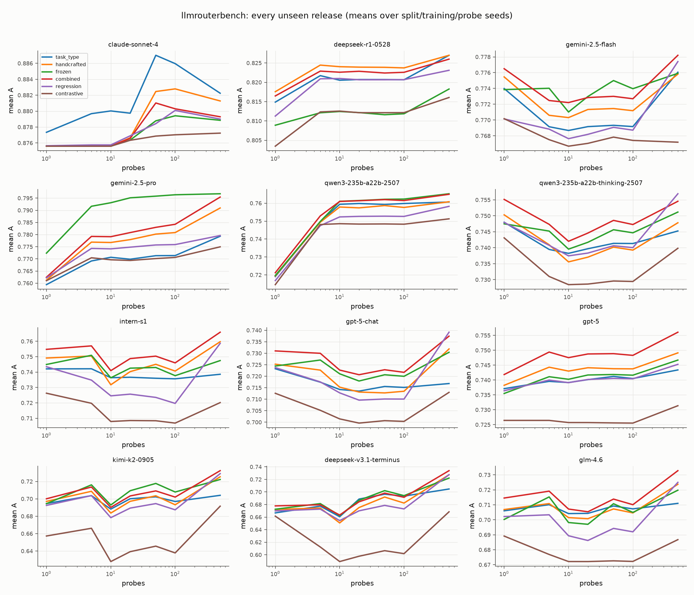
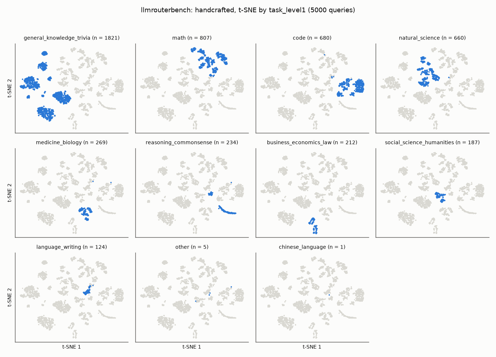
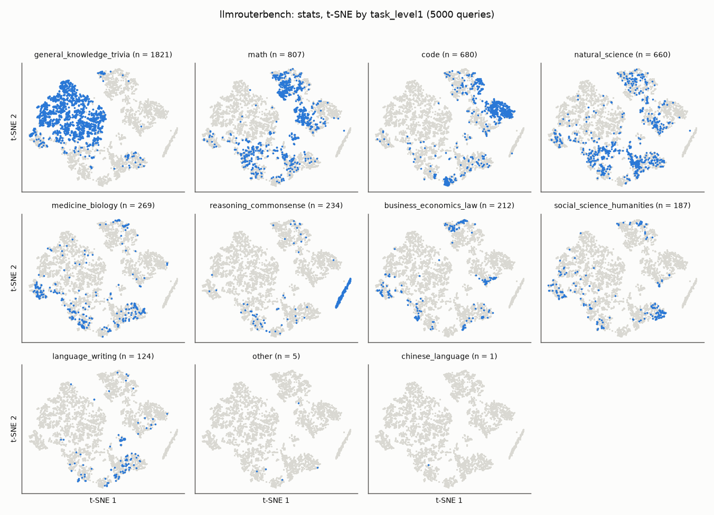
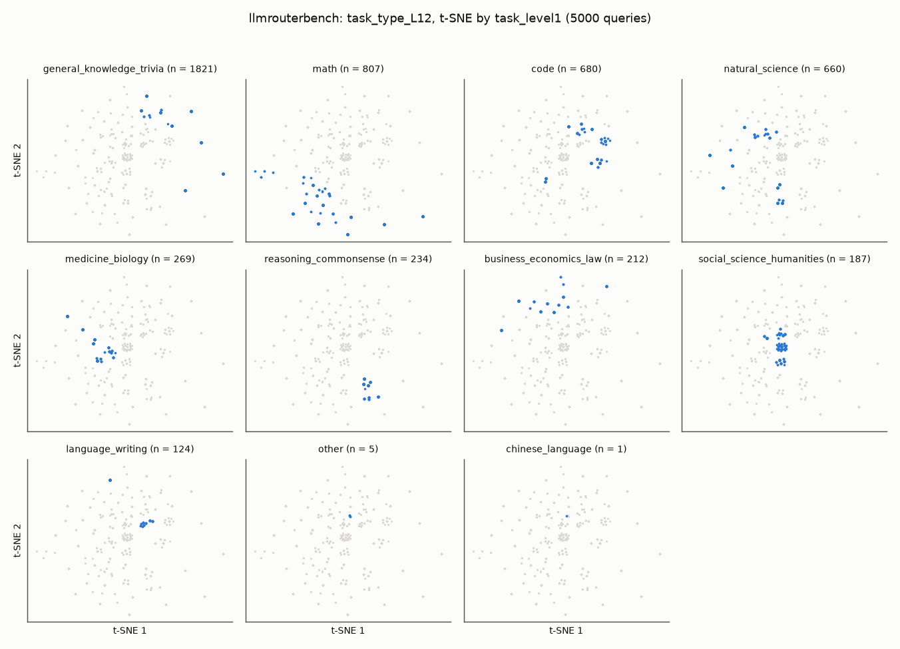
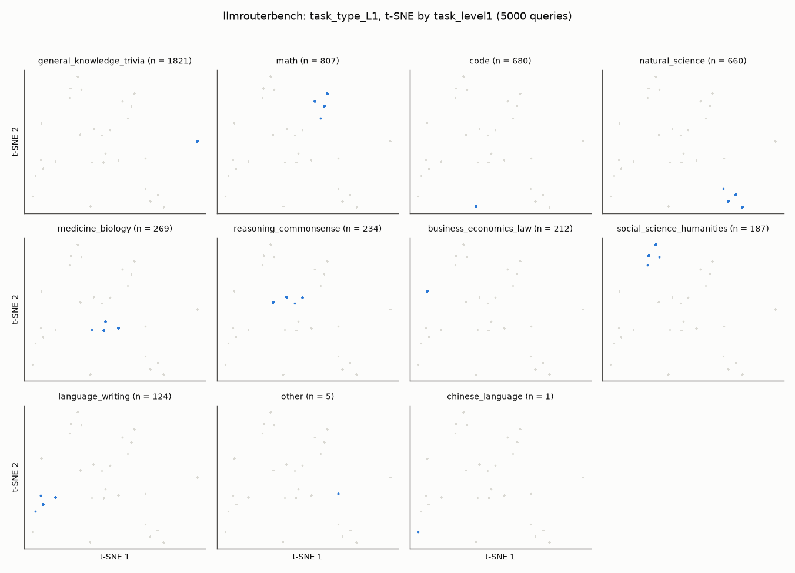

# Query representations for LLM routing: methods, experiments and findings

_Built 2026-11-21 at commit b5cd76c-dirty by `alexandros-handcrafted/build_report.py`; every table is generated from the result files named in each section._

## 1. In one paragraph

We route each query to one of several LLMs with a k-nearest-neighbour estimate of every model's quality in a query representation, and ask which representation routes best: a task-type label, handcrafted query statistics, a frozen sentence embedding, their concatenation, or an embedding learned from the models' scores (by regression or contrastively). Two benchmarks (LLMRouterBench, RouterBench), three splits, a replayed release timeline for the unseen-model setting, 1,000-sample bootstrap intervals per run, paired intervals for differences between representations, and PCA/t-SNE views of every representation coloured by task type at three levels of granularity. The observations are in section 6.

## 2. Data

| benchmark | queries | models | train / val / test (split 0) | themes | release instances | task labels L1 / L2 / L3 |
|---|---|---|---|---|---|---|
| llmrouterbench | 12,066 | 13 | 8,447 / 1,208 / 2,411 | 9 | 12 | 11 / 87 / 8,549 |
| routerbench | 36,478 | 11 | 25,535 / 3,648 / 7,295 | 12 | 9 | 11 / 84 / 15,228 |

**Benchmarks.** LLMRouterBench (primary): 21 source datasets reduced by Arman's preprocessing to 9 themes, 13 flagship models with list prices (DeepSeek-V3 to GLM-4.6, released March to September 2025), one score per model and query in [0, 1]. RouterBench (secondary): 8 datasets (12 themes, MMLU per subject), 11 models of 2023. Each benchmark has three random train/validation/test splits (70/10/20, stratified by theme), shared by every representation; the validation split is used only to choose the neighbourhood size k.

**Release timeline.** Models are replayed in release order. An *unseen instance* is one model held out: the pool is every model released before it plus the new one, whose scores are unknown except on n probe queries drawn from the training split (budgets 1, 5, 10, 20, 50, 100, 500; nested, the same probes for every representation).

**Task-type labels.** Besides the benchmark's own theme, every query carries a three-level task type assigned offline by Qwen3-32B with a closed taxonomy (11 Level-1 domains, 90 Level-2 subdomains, free-text Level 3). A stratified hand check of 200 rows per benchmark found Level 1 correct in 94.0% (LLMRouterBench) and 92.5% (RouterBench) of rows, Levels 1 and 2 both correct in 82.5% and 88.0% (`labeling/reports/handcheck_summary.md`).

## 3. Representations and methods

### 3.1 The query representations

| name in the tables | what it is | who |
|---|---|---|
| task_type | one-hot of the benchmark's theme (source dataset) | Nikhilesh |
| task_type_theme | one-hot of the benchmark's theme (source dataset) | shared |
| task_type_raw | one-hot of the benchmark's theme (source dataset) | Alexandros |
| task_type_L1 | one-hot of the LLM-assigned Level-1 domain (11) | Alexandros |
| task_type_L2 | one-hot of the Level-2 subdomain (~85) | Alexandros |
| task_type_L12 | one-hots of Level 1 and Level 2 side by side | Alexandros |
| task_type_L123 | Levels 1, 2 and the free-text Level 3 (thousands of columns) | Alexandros |
| stats | 15 z-scored query statistics (lengths, code/math markers, ...) | Alexandros |
| stats_whitened | the statistics after PCA whitening | Alexandros |
| stats_within_theme | the statistics, neighbours restricted to the query's theme | Alexandros |
| handcrafted | Level 1 + Level 2 one-hots + the 15 statistics (representation i) | Alexandros |
| handcrafted_L1 | Level 1 one-hot + the statistics | Alexandros |
| handcrafted_L123 | Levels 1-3 one-hots + the statistics | Alexandros |
| handcrafted_whitened | Levels 1-2 + whitened statistics | Alexandros |
| handcrafted_nik | theme one-hot + 3 length statistics, standardized (Nikhilesh's handcrafted) | Nikhilesh |
| frozen | all-MiniLM-L6-v2 sentence embedding, 384-d, L2-normalized (representation ii) | Nikhilesh |
| combined | frozen + handcrafted block (representation iii) | both |
| combined_balanced | frozen + handcrafted block with equal mean squared norms | Nikhilesh |
| regression | MLP on the sentence vector, trained to predict every model's score (iv) | Nikhilesh |
| contrastive | MLP on the sentence vector, trained to pull together queries with similar score profiles (iv) | Nikhilesh |
| regression_hc | the regression MLP on [sentence vector, our handcrafted block] | both |
| contrastive_hc | the contrastive MLP on [sentence vector, our handcrafted block] | both |

**The 15 query statistics** (Alexandros, `handcrafted.py`): token count (tiktoken cl100k), characters, words, sentences, lines, question marks, code-marker count and a code flag (backticks, braces, `def`, `return`, SQL, ...), digit, math-symbol and punctuation density, upper-case and non-ASCII fractions, average word length, characters per token. Counts are log1p-transformed, every statistic is z-scored on the training split and clipped at ±5 sd. The task-type block is one one-hot per level over the categories seen in training; it is scaled so that its total training variance equals the statistics block's ("balanced"), so neither block dominates the Euclidean distance.

**Nikhilesh's handcrafted features** differ: theme one-hot plus three raw length counts (characters, lexical tokens, lines), standardized column-wise. His `combined` concatenates the unit-norm sentence vector with that block (unweighted; a balanced version was also run).

### 3.2 The learned embeddings: regression and contrastive

Both start from the frozen MiniLM sentence vector (384-d) and train a small MLP, 384 → 128 → ReLU → 64, whose L2-normalized output is the embedding the router uses. They differ only in the training signal, which comes from the score table of the training queries and the models allowed in the pool:

- **Regression.** A linear head with a sigmoid predicts, from the 64-d embedding, the score of every allowed model on the query (its *quality profile*); the loss is the mean squared error. The head is discarded after training: only the embedding is used, so two queries end up close when the MLP needs similar coordinates to predict similar profiles.
- **Contrastive.** Pairs of queries in a minibatch are *positive* when the mean squared difference of their quality profiles is at most 0.1 (the models behave the same on them) and *negative* otherwise. Positives are pulled together (squared distance), negatives are pushed apart up to a margin of 1 (hinge, squared); the two terms are averaged separately so the many negatives do not drown the positives.

Training: Adam, learning rate 0.001, batch 128, at most 50 epochs, early stopping (patience 5) on 10% of the training queries held out for that purpose; `data.val` and `data.test` never enter training. In the unseen setting the held-out model's column is removed from the profiles, so the embedding is retrained without it; three training seeds. The `_hc` variants feed the MLP the concatenation [sentence vector, our handcrafted block] instead of the sentence vector alone.

### 3.3 The router and the metrics (Michal's harness)

For a query x and a model m, the router estimates the quality q̂_m(x) as the mean score of m over the k nearest training queries in the representation (Euclidean distance; a new model uses its probes as the labeled set). It then picks argmax_m q̂_m(x) − λ·cost(m), where cost(m) is the model's mean cost per query. Sweeping λ (0 plus 500 log-spaced values) traces a cost–quality curve on the test queries; **A** is the area under that curve (log-cost axis, best-quality-within-budget envelope) divided by the oracle's area (the oracle routes by the true test scores). The **single best** is the fixed model with the best q − λ·cost on the training queries; **gain** = area(router) / area(single best) − 1 is the main number, and it is the same baseline in the seen and the unseen setting, so the unseen curve against n reflects the router only. **Recovery** = unseen gain / seen gain of the same representation and pool. k is chosen on the validation split by the one-standard-error rule (largest k whose validation area is within one bootstrap standard error of the best).

### 3.4 Statistics

- **Bootstrap intervals.** Every run has a 95% paired percentile bootstrap interval of its gain over 1,000 resamples of the test queries (the router and the single best are resampled together).
- **Paired differences between representations** (`paired_tests.py`): on the same split and pool, the difference of two representations' gains is recomputed on 1,000 shared resamples of the test queries, which gives an interval and a two-sided bootstrap p-value for the difference itself.
- **Three sources of spread, kept separate:** across the three splits (reported as ± sd of split means), across training seeds (learned embeddings) and across probe draws (unseen). With three splits these are descriptive, not tests; the paired test-query intervals are the inferential evidence.
- **Task-type recovery** (RQ1a) = A(task-type one-hot) / A(learned embedding), same pool and seeds; **probes-to-target** = the smallest budget whose A_unseen reaches 90% of the seen A (the proposal's definition) or whose recovery reaches 90%.
- **Embedding structure** (`embedding_views.py`): PCA and t-SNE small multiples by theme, Level 1 and Level 2, plus the share of a test query's 10 nearest training neighbours with the same label (what the router sees), a linear probe's test accuracy and the silhouette of the labels.

## 4. Protocol summary

| setting | what the router knows | evaluated on | reported |
|---|---|---|---|
| seen (final pool) | all models known on all training queries | test queries of the split | gain, A, 95% bootstrap |
| seen (instance pool) | the models released before the event plus the new one, all known | test queries | the reference of recovery |
| unseen | the new model known only from n probes (1 … 500), the embedding trained without it | test queries | gain, gain (same probes), recovery |

Seeds: 3 splits (0, 1, 2); 3 training seeds for the learned embeddings; 3 probe seeds (5 in the handcrafted-only runs). k grid 5 … 200 in Nikhilesh's grid, 5 … 1000 in the handcrafted and unified runs.

## 5. Results

### 5.1 Seen setting

**Nikhilesh's grid (theme label, his handcrafted features, frozen, combined, regression, contrastive)**

Means over 3 splits × 3 training seeds (deterministic representations are identical across training seeds). The bootstrap column is the mean half-width of the per-run 95% test-query interval.

| benchmark | representation | gain ± sd over splits | bootstrap 95% half-width | A | A sd over training seeds |
|---|---|---|---|---|---|
| llmrouterbench | combined | +6.18% ± 0.81% | ± 1.40% | 0.7385 | 0 |
| llmrouterbench | handcrafted | +4.91% ± 0.91% | ± 1.34% | 0.7297 | 0 |
| llmrouterbench | frozen | +4.86% ± 0.79% | ± 1.31% | 0.7294 | 0 |
| llmrouterbench | regression | +4.47% ± 1.20% | ± 1.38% | 0.7266 | 0.0037 |
| llmrouterbench | task_type | +4.05% ± 1.13% | ± 1.45% | 0.7238 | 0 |
| llmrouterbench | contrastive | +2.38% ± 0.32% | ± 1.29% | 0.7121 | 0.0032 |
| routerbench | combined | +7.98% ± 0.37% | ± 0.79% | 0.7731 | 0 |
| routerbench | regression | +7.71% ± 0.39% | ± 0.83% | 0.7711 | 0.0009 |
| routerbench | frozen | +7.64% ± 0.47% | ± 0.81% | 0.7706 | 0 |
| routerbench | contrastive | +7.60% ± 0.34% | ± 0.81% | 0.7703 | 0.0019 |
| routerbench | handcrafted | +7.29% ± 0.48% | ± 0.79% | 0.7681 | 0 |
| routerbench | task_type | +3.83% ± 0.56% | ± 0.53% | 0.7433 | 0 |

**Handcrafted variants with our task-type levels**

Handcrafted variants (Alexandros' runs of 2026-11-16, commit cde8206; 3 splits, k grid 5 … 1000). † = the selected k is the top of the grid on at least one split (the validation curve is flat up to the top, see RESULTS.md).

| benchmark | variant | gain ± sd over splits | bootstrap 95% half-width | A | k per split |
|---|---|---|---|---|---|
| llmrouterbench | stats_within_theme | +5.47% ± 0.62% | ± 1.35% | 0.7337 | 1000 1000 1000 † |
| llmrouterbench | handcrafted_L1 | +4.88% ± 0.48% | ± 1.30% | 0.7295 | 1000 1000 1000 † |
| llmrouterbench | task_type_raw | +4.77% ± 0.85% | ± 1.28% | 0.7287 | 1000 1000 1000 † |
| llmrouterbench | handcrafted | +4.73% ± 0.33% | ± 1.29% | 0.7285 | 1000 1000 1000 † |
| llmrouterbench | handcrafted_L123 | +4.68% ± 0.35% | ± 1.24% | 0.7282 | 1000 1000 1000 † |
| llmrouterbench | stats | +4.42% ± 0.39% | ± 1.17% | 0.7263 | 1000 1000 1000 † |
| llmrouterbench | handcrafted_whitened | +4.33% ± 0.33% | ± 1.22% | 0.7257 | 1000 1000 1000 † |
| llmrouterbench | task_type_L123 | +4.16% ± 0.41% | ± 1.36% | 0.7245 | 1000 1000 1000 † |
| llmrouterbench | task_type_L12 | +4.14% ± 0.43% | ± 1.37% | 0.7244 | 1000 1000 1000 † |
| llmrouterbench | task_type_L1 | +3.94% ± 0.06% | ± 1.26% | 0.7230 | 1000 1000 1000 † |
| llmrouterbench | stats_whitened | +3.53% ± 0.41% | ± 1.05% | 0.7202 | 1000 1000 1000 † |
| llmrouterbench | task_type_L2 | +3.48% ± 0.50% | ± 1.11% | 0.7198 | 1000 1000 1000 † |
| routerbench | handcrafted_L123 | +7.62% ± 0.48% | ± 0.78% | 0.7705 | 500 500 1000 † |
| routerbench | stats_within_theme | +7.42% ± 0.40% | ± 0.82% | 0.7691 | 1000 1000 1000 † |
| routerbench | handcrafted_whitened | +7.42% ± 0.43% | ± 0.79% | 0.7691 | 500 1000 1000 † |
| routerbench | handcrafted | +7.41% ± 0.28% | ± 0.80% | 0.7690 | 1000 1000 1000 † |
| routerbench | handcrafted_L1 | +7.33% ± 0.30% | ± 0.80% | 0.7684 | 1000 1000 1000 † |
| routerbench | stats_whitened | +7.15% ± 0.19% | ± 0.77% | 0.7671 | 1000 1000 1000 † |
| routerbench | stats | +7.07% ± 0.30% | ± 0.77% | 0.7666 | 1000 1000 1000 † |
| routerbench | task_type_L123 | +4.89% ± 0.93% | ± 0.86% | 0.7509 | 100 200 200 |
| routerbench | task_type_L2 | +3.97% ± 0.71% | ± 0.75% | 0.7444 | 100 50 100 |
| routerbench | task_type_raw | +3.85% ± 0.42% | ± 0.52% | 0.7435 | 50 100 50 |
| routerbench | task_type_L12 | +3.70% ± 0.42% | ± 0.77% | 0.7424 | 100 50 200 |
| routerbench | task_type_L1 | +2.62% ± 0.33% | ± 0.66% | 0.7347 | 200 200 200 |

### 5.2 Unseen setting (a new model with n probes)

Seen gain on the final pool against the unseen gain (mean over every release instance, 3 splits, 3 training seeds, 3 probe seeds) at three probe budgets, with the rank of each representation per column; recovery is the unseen gain divided by the seen gain of the same instance pool, averaged over instances.

| benchmark | representation | seen gain (rank) | unseen gain, n=5 (rank) | unseen gain, n=50 (rank) | unseen gain, n=500 (rank) | recovery n=5 | recovery n=50 | recovery n=500 |
|---|---|---|---|---|---|---|---|---|
| llmrouterbench | combined | +6.18% (1) | +1.09% (1) | +1.24% (1) | +2.91% (1) | 0.21 | 0.24 | 0.54 |
| llmrouterbench | handcrafted | +4.91% (2) | +0.51% (3) | +0.63% (3) | +2.26% (2) | 0.12 | 0.15 | 0.50 |
| llmrouterbench | frozen | +4.86% (3) | +0.88% (2) | +1.16% (2) | +1.96% (4) | 0.19 | 0.25 | 0.44 |
| llmrouterbench | regression | +4.47% (4) | -0.05% (5) | -0.31% (5) | +2.25% (3) | -0.00 | -0.06 | 0.61 |
| llmrouterbench | task_type | +4.05% (5) | +0.16% (4) | +0.51% (4) | +0.95% (5) | 0.05 | 0.14 | 0.27 |
| llmrouterbench | contrastive | +2.38% (6) | -2.25% (6) | -2.81% (6) | -0.78% (6) | -1.02 | -1.24 | -0.39 |
| routerbench | combined | +7.98% (1) | -0.34% (2) | +2.25% (1) | +2.58% (2) | -0.27 | 0.51 | 0.61 |
| routerbench | regression | +7.71% (2) | -0.57% (5) | +1.46% (5) | +2.10% (4) | -0.34 | 0.32 | 0.53 |
| routerbench | frozen | +7.64% (3) | -0.46% (3) | +2.08% (2) | +2.58% (1) | -0.32 | 0.52 | 0.64 |
| routerbench | contrastive | +7.60% (4) | +0.05% (1) | +1.73% (4) | +2.05% (5) | -0.09 | 0.46 | 0.57 |
| routerbench | handcrafted | +7.29% (5) | -0.46% (4) | +1.90% (3) | +2.28% (3) | -0.30 | 0.47 | 0.60 |
| routerbench | task_type | +3.83% (6) | -3.17% (6) | +1.03% (6) | +1.32% (6) | -1.72 | 0.46 | 0.55 |

A at 500 probes, every release instance of llmrouterbench (mean over seeds; compare within a row, pools differ):

| instance | new model | combined | contrastive | frozen | handcrafted | regression | task_type |
|---|---|---|---|---|---|---|---|
| 0 | claude-sonnet-4 | 0.8793 | 0.8772 | 0.8788 | 0.8813 | 0.8790 | 0.8822 |
| 1 | deepseek-r1-0528 | 0.8260 | 0.8161 | 0.8183 | 0.8270 | 0.8231 | 0.8270 |
| 2 | gemini-2.5-flash | 0.7782 | 0.7672 | 0.7759 | 0.7758 | 0.7774 | 0.7761 |
| 3 | gemini-2.5-pro | 0.7954 | 0.7750 | 0.7968 | 0.7909 | 0.7796 | 0.7793 |
| 4 | qwen3-235b-a22b-2507 | 0.7650 | 0.7513 | 0.7653 | 0.7608 | 0.7582 | 0.7607 |
| 5 | qwen3-235b-a22b-thinking-2507 | 0.7546 | 0.7398 | 0.7512 | 0.7478 | 0.7569 | 0.7453 |
| 6 | intern-s1 | 0.7659 | 0.7202 | 0.7475 | 0.7598 | 0.7587 | 0.7386 |
| 7 | gpt-5-chat | 0.7374 | 0.7130 | 0.7304 | 0.7319 | 0.7392 | 0.7168 |
| 8 | gpt-5 | 0.7561 | 0.7314 | 0.7467 | 0.7491 | 0.7453 | 0.7434 |
| 9 | kimi-k2-0905 | 0.7324 | 0.6915 | 0.7222 | 0.7254 | 0.7290 | 0.7040 |
| 10 | deepseek-v3.1-terminus | 0.7339 | 0.6684 | 0.7221 | 0.7274 | 0.7275 | 0.7047 |
| 11 | glm-4.6 | 0.7328 | 0.6868 | 0.7198 | 0.7237 | 0.7250 | 0.7110 |

A at 500 probes, every release instance of routerbench (mean over seeds; compare within a row, pools differ):

| instance | new model | combined | contrastive | frozen | handcrafted | regression | task_type |
|---|---|---|---|---|---|---|---|
| 0 | claude-v2 | 0.8478 | 0.8441 | 0.8477 | 0.8484 | 0.8479 | 0.8397 |
| 1 | meta/llama-2-70b-chat | 0.8484 | 0.8433 | 0.8449 | 0.8466 | 0.8332 | 0.8438 |
| 2 | WizardLM/WizardLM-13B-V1.2 | 0.7990 | 0.7962 | 0.7969 | 0.7972 | 0.7977 | 0.7867 |
| 3 | meta/code-llama-instruct-34b-chat | 0.7626 | 0.7588 | 0.7608 | 0.7608 | 0.7608 | 0.7492 |
| 4 | mistralai/mistral-7b-chat | 0.7163 | 0.7128 | 0.7155 | 0.7139 | 0.7137 | 0.7047 |
| 5 | gpt-3.5-turbo-1106 | 0.6935 | 0.6920 | 0.6949 | 0.6944 | 0.6939 | 0.6979 |
| 6 | gpt-4-1106-preview | 0.7381 | 0.7340 | 0.7370 | 0.7353 | 0.7346 | 0.7275 |
| 7 | zero-one-ai/Yi-34B-Chat | 0.7430 | 0.7348 | 0.7473 | 0.7379 | 0.7305 | 0.7427 |
| 8 | mistralai/mixtral-8x7b-chat | 0.7560 | 0.7532 | 0.7590 | 0.7503 | 0.7592 | 0.7283 |

`handcrafted`, every model held out in turn from the full pool (3 splits × 5 probe seeds; mean over held-out models). `gain (same probes)` is over the single best that knows the new model only from the same n probes.

| benchmark | n probes | gain | gain (same probes) | recovery | A |
|---|---|---|---|---|---|
| llmrouterbench | 1 | -0.25% | +2.80% | -0.05 | 0.6939 |
| llmrouterbench | 2 | +2.39% | +3.18% | 0.51 | 0.7122 |
| llmrouterbench | 5 | +2.60% | +3.99% | 0.55 | 0.7136 |
| llmrouterbench | 10 | +1.09% | +3.14% | 0.23 | 0.7031 |
| llmrouterbench | 20 | +2.59% | +3.27% | 0.54 | 0.7136 |
| llmrouterbench | 50 | +3.07% | +3.32% | 0.64 | 0.7169 |
| llmrouterbench | 100 | +2.99% | +3.42% | 0.62 | 0.7164 |
| llmrouterbench | 500 | +3.81% | +3.85% | 0.80 | 0.7221 |
| routerbench | 1 | +0.35% | +6.45% | 0.04 | 0.7184 |
| routerbench | 2 | +3.53% | +6.93% | 0.47 | 0.7411 |
| routerbench | 5 | +4.88% | +7.16% | 0.66 | 0.7508 |
| routerbench | 10 | +5.36% | +7.28% | 0.72 | 0.7543 |
| routerbench | 20 | +5.82% | +6.74% | 0.78 | 0.7576 |
| routerbench | 50 | +6.23% | +6.38% | 0.84 | 0.7605 |
| routerbench | 100 | +6.27% | +6.34% | 0.85 | 0.7608 |
| routerbench | 500 | +6.33% | +6.34% | 0.85 | 0.7612 |

How well the 15 statistics alone identify the task type (train → test):

| benchmark | label | classes | majority | logistic regression | kNN (k = 50) |
|---|---|---|---|---|---|
| llmrouterbench | theme | 9 | 35.9% | 79.1% | 78.6% |
| llmrouterbench | task_level1 | 11 | 37.0% | 71.0% | 69.9% |
| routerbench | theme | 12 | 38.5% | 99.3% | 95.7% |
| routerbench | task_level1 | 11 | 32.0% | 76.9% | 80.5% |

### 5.3 Unified comparison with our Level-1/Level-2 labels (all representations, same protocol)

_Not run yet._ `compare_representations.py` puts every representation, including the learned ones and the `_hc` variants, through the same protocol with our Level-1/Level-2 labels; this section fills itself from `results_compare/metrics.csv` once the run has finished (see section 7).

### 5.4 Paired comparisons

Paired bootstrap over the test queries, final pool, seen setting: difference of gains on the same split, mean ± sd over splits; `wins` = splits where a > b; `CI excl. 0` = splits whose 95% paired interval excludes zero; p = median two-sided bootstrap p over splits.

| benchmark | a − b | Δ gain | wins | CI excl. 0 | median p |
|---|---|---|---|---|---|
| llmrouterbench | stats_within_theme − handcrafted | +0.74% ± 0.30% | 3 / 3 | 1 / 3 | 0.070 |
| llmrouterbench | handcrafted_L1 − handcrafted | +0.15% ± 0.16% | 2 / 3 | 0 / 3 | 0.290 |
| llmrouterbench | task_type_raw − handcrafted | +0.04% ± 0.52% | 2 / 3 | 0 / 3 | 0.178 |
| llmrouterbench | handcrafted_L123 − handcrafted | -0.05% ± 0.02% | 0 / 3 | 0 / 3 | 0.762 |
| llmrouterbench | stats − handcrafted | -0.32% ± 0.07% | 0 / 3 | 0 / 3 | 0.420 |
| llmrouterbench | handcrafted_whitened − handcrafted | -0.40% ± 0.01% | 0 / 3 | 0 / 3 | 0.144 |
| llmrouterbench | task_type_L123 − handcrafted | -0.57% ± 0.16% | 0 / 3 | 1 / 3 | 0.128 |
| llmrouterbench | task_type_L12 − handcrafted | -0.59% ± 0.18% | 0 / 3 | 1 / 3 | 0.112 |
| llmrouterbench | task_type_L1 − handcrafted | -0.79% ± 0.27% | 0 / 3 | 2 / 3 | 0.014 |
| llmrouterbench | stats_whitened − handcrafted | -1.20% ± 0.11% | 0 / 3 | 3 / 3 | 0.006 |
| llmrouterbench | task_type_L2 − handcrafted | -1.26% ± 0.18% | 0 / 3 | 3 / 3 | 0.006 |
| routerbench | handcrafted_L123 − handcrafted | +0.21% ± 0.21% | 2 / 3 | 2 / 3 | 0.012 |
| routerbench | stats_within_theme − handcrafted | +0.02% ± 0.15% | 2 / 3 | 0 / 3 | 0.348 |
| routerbench | handcrafted_whitened − handcrafted | +0.02% ± 0.15% | 2 / 3 | 0 / 3 | 0.230 |
| routerbench | handcrafted_L1 − handcrafted | -0.08% ± 0.02% | 0 / 3 | 0 / 3 | 0.516 |
| routerbench | stats_whitened − handcrafted | -0.26% ± 0.10% | 0 / 3 | 0 / 3 | 0.200 |
| routerbench | stats − handcrafted | -0.33% ± 0.03% | 0 / 3 | 0 / 3 | 0.102 |
| routerbench | task_type_L123 − handcrafted | -2.52% ± 0.85% | 0 / 3 | 3 / 3 | 0.000 |
| routerbench | task_type_L2 − handcrafted | -3.44% ± 0.87% | 0 / 3 | 3 / 3 | 0.000 |
| routerbench | task_type_raw − handcrafted | -3.55% ± 0.48% | 0 / 3 | 3 / 3 | 0.000 |
| routerbench | task_type_L12 − handcrafted | -3.71% ± 0.40% | 0 / 3 | 3 / 3 | 0.000 |
| routerbench | task_type_L1 − handcrafted | -4.78% ± 0.33% | 0 / 3 | 3 / 3 | 0.000 |

### 5.5 Embedding structure: PCA, t-SNE and label purity

Is a representation "just the task type"? Share of a test query's 10 nearest training neighbours with the same label (what the router averages over), a linear probe's test accuracy, and the silhouette of the labels:

| benchmark | representation | label | classes | majority | kNN purity | linear probe | silhouette |
|---|---|---|---|---|---|---|---|
| llmrouterbench | task_type_L1 | task_level1 | 11 | 36.7% | 100.0% | 100.0% | 0.999 |
| llmrouterbench | task_type_L12 | task_level1 | 11 | 36.7% | 100.0% | 100.0% | 0.480 |
| llmrouterbench | handcrafted | task_level1 | 11 | 36.7% | 99.8% | 100.0% | 0.272 |
| llmrouterbench | stats | task_level1 | 11 | 36.7% | 65.2% | 71.0% | 0.023 |
| llmrouterbench | task_type_L12 | task_level2 | 85 | 9.9% | 99.1% | 100.0% | 0.973 |
| llmrouterbench | handcrafted | task_level2 | 85 | 9.9% | 97.5% | 100.0% | 0.412 |
| llmrouterbench | stats | task_level2 | 85 | 9.9% | 30.1% | 39.6% | -0.233 |
| llmrouterbench | task_type_L1 | task_level2 | 85 | 9.9% | 20.5% | 37.3% | -0.184 |
| llmrouterbench | handcrafted | theme | 9 | 35.8% | 84.4% | 88.8% | 0.174 |
| llmrouterbench | stats | theme | 9 | 35.8% | 74.0% | 79.2% | 0.131 |
| llmrouterbench | task_type_L12 | theme | 9 | 35.8% | 28.6% | 82.3% | 0.183 |
| llmrouterbench | task_type_L1 | theme | 9 | 35.8% | 9.1% | 76.6% | 0.189 |
| routerbench | task_type_L1 | task_level1 | 11 | 31.9% | 100.0% | 100.0% | 1.000 |
| routerbench | task_type_L12 | task_level1 | 11 | 31.9% | 100.0% | 100.0% | 0.673 |
| routerbench | handcrafted | task_level1 | 11 | 31.9% | 99.9% | 100.0% | 0.383 |
| routerbench | stats | task_level1 | 11 | 31.9% | 77.3% | 76.9% | 0.061 |
| routerbench | task_type_L12 | task_level2 | 83 | 27.6% | 99.8% | 100.0% | 0.976 |
| routerbench | handcrafted | task_level2 | 83 | 27.6% | 99.5% | 100.0% | 0.456 |
| routerbench | stats | task_level2 | 83 | 27.6% | 69.7% | 72.5% | -0.211 |
| routerbench | task_type_L1 | task_level2 | 83 | 27.6% | 33.0% | 66.8% | -0.106 |
| routerbench | handcrafted | theme | 12 | 38.5% | 97.7% | 99.6% | 0.315 |
| routerbench | stats | theme | 12 | 38.5% | 95.8% | 99.3% | 0.107 |
| routerbench | task_type_L12 | theme | 12 | 38.5% | 37.6% | 95.1% | 0.503 |
| routerbench | task_type_L1 | theme | 12 | 38.5% | 15.9% | 86.0% | -0.105 |

Figures (PCA and t-SNE small multiples, one panel per category, the category in blue over all queries in gray):

- llmrouterbench, `handcrafted`: [pca by task_level1](analysis_compare/views/llmrouterbench_handcrafted_pca_task_level1.png), [pca by task_level2](analysis_compare/views/llmrouterbench_handcrafted_pca_task_level2.png), [pca by theme](analysis_compare/views/llmrouterbench_handcrafted_pca_theme.png), [tsne by task_level1](analysis_compare/views/llmrouterbench_handcrafted_tsne_task_level1.png), [tsne by task_level2](analysis_compare/views/llmrouterbench_handcrafted_tsne_task_level2.png), [tsne by theme](analysis_compare/views/llmrouterbench_handcrafted_tsne_theme.png)
- llmrouterbench, `stats`: [pca by task_level1](analysis_compare/views/llmrouterbench_stats_pca_task_level1.png), [pca by task_level2](analysis_compare/views/llmrouterbench_stats_pca_task_level2.png), [pca by theme](analysis_compare/views/llmrouterbench_stats_pca_theme.png), [tsne by task_level1](analysis_compare/views/llmrouterbench_stats_tsne_task_level1.png), [tsne by task_level2](analysis_compare/views/llmrouterbench_stats_tsne_task_level2.png), [tsne by theme](analysis_compare/views/llmrouterbench_stats_tsne_theme.png)
- llmrouterbench, `task_type_L1`: [pca by task_level1](analysis_compare/views/llmrouterbench_task_type_L1_pca_task_level1.png), [pca by task_level2](analysis_compare/views/llmrouterbench_task_type_L1_pca_task_level2.png), [pca by theme](analysis_compare/views/llmrouterbench_task_type_L1_pca_theme.png), [tsne by task_level1](analysis_compare/views/llmrouterbench_task_type_L1_tsne_task_level1.png), [tsne by task_level2](analysis_compare/views/llmrouterbench_task_type_L1_tsne_task_level2.png), [tsne by theme](analysis_compare/views/llmrouterbench_task_type_L1_tsne_theme.png)
- llmrouterbench, `task_type_L12`: [pca by task_level1](analysis_compare/views/llmrouterbench_task_type_L12_pca_task_level1.png), [pca by task_level2](analysis_compare/views/llmrouterbench_task_type_L12_pca_task_level2.png), [pca by theme](analysis_compare/views/llmrouterbench_task_type_L12_pca_theme.png), [tsne by task_level1](analysis_compare/views/llmrouterbench_task_type_L12_tsne_task_level1.png), [tsne by task_level2](analysis_compare/views/llmrouterbench_task_type_L12_tsne_task_level2.png), [tsne by theme](analysis_compare/views/llmrouterbench_task_type_L12_tsne_theme.png)
- routerbench, `handcrafted`: [pca by task_level1](analysis_compare/views/routerbench_handcrafted_pca_task_level1.png), [pca by task_level2](analysis_compare/views/routerbench_handcrafted_pca_task_level2.png), [pca by theme](analysis_compare/views/routerbench_handcrafted_pca_theme.png), [tsne by task_level1](analysis_compare/views/routerbench_handcrafted_tsne_task_level1.png), [tsne by task_level2](analysis_compare/views/routerbench_handcrafted_tsne_task_level2.png), [tsne by theme](analysis_compare/views/routerbench_handcrafted_tsne_theme.png)
- routerbench, `stats`: [pca by task_level1](analysis_compare/views/routerbench_stats_pca_task_level1.png), [pca by task_level2](analysis_compare/views/routerbench_stats_pca_task_level2.png), [pca by theme](analysis_compare/views/routerbench_stats_pca_theme.png), [tsne by task_level1](analysis_compare/views/routerbench_stats_tsne_task_level1.png), [tsne by task_level2](analysis_compare/views/routerbench_stats_tsne_task_level2.png), [tsne by theme](analysis_compare/views/routerbench_stats_tsne_theme.png)
- routerbench, `task_type_L1`: [pca by task_level1](analysis_compare/views/routerbench_task_type_L1_pca_task_level1.png), [pca by task_level2](analysis_compare/views/routerbench_task_type_L1_pca_task_level2.png), [pca by theme](analysis_compare/views/routerbench_task_type_L1_pca_theme.png), [tsne by task_level1](analysis_compare/views/routerbench_task_type_L1_tsne_task_level1.png), [tsne by task_level2](analysis_compare/views/routerbench_task_type_L1_tsne_task_level2.png), [tsne by theme](analysis_compare/views/routerbench_task_type_L1_tsne_theme.png)
- routerbench, `task_type_L12`: [pca by task_level1](analysis_compare/views/routerbench_task_type_L12_pca_task_level1.png), [pca by task_level2](analysis_compare/views/routerbench_task_type_L12_pca_task_level2.png), [pca by theme](analysis_compare/views/routerbench_task_type_L12_pca_theme.png), [tsne by task_level1](analysis_compare/views/routerbench_task_type_L12_tsne_task_level1.png), [tsne by task_level2](analysis_compare/views/routerbench_task_type_L12_tsne_task_level2.png), [tsne by theme](analysis_compare/views/routerbench_task_type_L12_tsne_theme.png)

### 5.6 Task-type recovery, probes-to-target and sensitivity

Task-type recovery with the *theme* one-hot (Nikhilesh's grid): A(task_type) / A(learned), final pool.

| benchmark | learned objective | recovery | sd over splits |
|---|---|---|---|
| llmrouterbench | contrastive | 1.0164 | 0.0094 |
| llmrouterbench | regression | 0.9961 | 0.0030 |
| routerbench | contrastive | 0.9649 | 0.0063 |
| routerbench | regression | 0.9639 | 0.0055 |

Probes-to-target (90% of the seen A): 3,402 of 3,402 cases reach it within the tested budgets, 2,971 at one probe. The A-based target is uninformative here: the single best alone already has A ≥ 0.9·A_seen (0.955 on LLMRouterBench, 0.931 on RouterBench), so the recovery-based target in section 5.2 is the one to read.

Sensitivity (one factor at a time, every main run; paired absolute change of A from the reference run):

| benchmark | variant | 95th percentile |ΔA| | max |ΔA| |
|---|---|---|---|
| llmrouterbench | k10 | 0.0423 | 0.0926 |
| llmrouterbench | k100 | 0.0100 | 0.0724 |
| llmrouterbench | k20 | 0.0287 | 0.1442 |
| llmrouterbench | k200 | 0.0008 | 0.0174 |
| llmrouterbench | k400 | 0.0134 | 0.0764 |
| llmrouterbench | k5 | 0.0617 | 0.1228 |
| llmrouterbench | k50 | 0.0189 | 0.0941 |
| llmrouterbench | lambda_points100 | 0.0015 | 0.0107 |
| llmrouterbench | lambda_points1000 | 0.0005 | 0.0708 |
| llmrouterbench | lambda_range_narrow | 0.0011 | 0.0141 |
| llmrouterbench | lambda_range_wide | 0.0006 | 0.0044 |
| routerbench | k10 | 0.0822 | 0.3235 |
| routerbench | k100 | 0.0157 | 0.3121 |
| routerbench | k20 | 0.0633 | 0.3234 |
| routerbench | k200 | 0.0000 | 0.0347 |
| routerbench | k400 | 0.0095 | 0.1817 |
| routerbench | k5 | 0.1569 | 0.3122 |
| routerbench | k50 | 0.0610 | 0.3120 |
| routerbench | lambda_points100 | 0.0005 | 0.0085 |
| routerbench | lambda_points1000 | 0.0001 | 0.0021 |
| routerbench | lambda_range_narrow | 0.0020 | 0.0110 |
| routerbench | lambda_range_wide | 0.0001 | 0.0026 |

k matters (fixed k = 5 or 10 moves A by up to 0.1–0.3), the λ grid barely (95th percentile below 0.002).

## 6. Observations

1. **Every representation beats the single best model in the seen setting, by +4.05%–+6.18% on LLMRouterBench and +3.83%–+7.98% on RouterBench** (Nikhilesh's grid), with per-run bootstrap half-widths of about ±1.0–1.5 points, so the gains themselves are not noise, but the differences between the better representations are of the order of one split standard deviation.
2. **The learned embeddings do not beat the frozen or handcrafted ones in the seen setting.** Regression is at +4.47% / +7.71% against +4.86% / +7.64% for the frozen sentence vector it is trained from; contrastive is the weakest representation on LLMRouterBench (+2.38%). The task-type recovery ratios are 0.96–1.02: the theme one-hot alone does about as well as either learned embedding.
3. **Concatenation wins where it was tried.** `combined` (sentence vector + handcrafted) is the best entry in Nikhilesh's seen tables (+6.18% and +7.98%); balancing the blocks changes it by less than a split sd.
4. **Within the handcrafted family, the query statistics carry most of the signal.** Our `handcrafted` (L1 + L2 + 15 statistics) gains +4.73% / +7.41%; the statistics alone +4.42% / +7.07%; the Level-1 label alone +3.94% / +2.62%. On RouterBench the statistics identify the theme almost perfectly (99% test accuracy) yet beat the theme one-hot by 3 points: within a theme, length and code/math markers still separate easy from hard queries. The free-text Level 3 is not worth its thousands of columns.
5. **Seen versus unseen: no reversal.** On llmrouterbench `combined` leads the seen setting and `combined` the unseen setting at 500 probes; handcrafted against frozen is +4.91% vs +4.86% seen and +2.26% vs +1.96% unseen (n = 500). On routerbench `combined` leads the seen setting and `frozen` the unseen setting at 500 probes; handcrafted against frozen is +7.29% vs +7.64% seen and +2.28% vs +2.58% unseen (n = 500). The hypothesis "handcrafted is best when the models are known, frozen when a model is new" is not supported by Nikhilesh's grid: a representation that leads in the seen setting keeps roughly its place with a new model, and the loss with a new model is the probe budget, not the representation. With our `handcrafted`, 5 probes recover 55% (LLMRouterBench) and 66% (RouterBench) of the seen gain, 50 probes 64% and 84%, 500 probes 80% and 85%; with one probe the router can lose to the single best on a third of the models. The unified comparison (section 5.3) repeats the test with the same features on both sides and paired intervals.
6. **Is the learned embedding just task type?** Section 5.5 gives, per representation, the share of a query's 10 nearest neighbours with the same label and a linear probe's accuracy. The task-type one-hots have 100% purity for their own level by construction, and `handcrafted` keeps it (99.8% / 99.9% at Level 1): with the balanced weighting, a neighbour is first a same-domain query. The statistics alone reach 65% / 77% Level-1 purity (majority 37% / 32%), i.e. length and markers identify the domain only partly, yet they route better than the Level-1 one-hot (observation 4). The purity and probe numbers of `frozen`, `regression` and `contrastive` on the real encoder appear once the unified run has exported their embeddings.
7. **k is the sensitive hyperparameter, not λ.** Fixed k = 5 or 10 changes A by up to 0.1 (LLMRouterBench) and 0.3 (RouterBench) in single runs; the λ grid density and range change it by less than 0.002 at the 95th percentile. Every variant containing the statistics selects the top of the k grid: the router is a wide local average.

## 7. What is pending and how to reproduce

Pending (needs the sentence encoder and a compute node; Alexandros runs these):

1. The unified comparison with our labels: `bash alexandros-handcrafted/run_compare_all.sh` (six detached processes, one per benchmark and split; resumable) after `python alexandros-handcrafted/compare_representations.py --encode-only`. Or the SLURM job `alexandros-handcrafted/sbatch/compare_vista.slurm`.
2. The views of the frozen and learned embeddings: `python alexandros-handcrafted/embedding_views.py` (reads `results_compare/embeddings/`).
3. Paired tests on the unified run: `python alexandros-handcrafted/paired_tests.py --compare-root results_compare --reference handcrafted --n-probes 5 50 500`.
4. `python alexandros-handcrafted/build_report.py` to refresh this report.

Already in the repository: Nikhilesh's grid (`results_summary/`, `learned/README.md`), the handcrafted runs (`alexandros-handcrafted/RESULTS.md`, `analysis/`), the task labels (`preproc/data/<benchmark>/task_labels.parquet`, `labeling/`), the paired comparisons and views of the handcrafted variants (`analysis_compare/`).
