# Query representations for LLM routing: methods, experiments and findings

_Built 2026-11-22 at commit b45d98e-dirty by `alexandros-handcrafted/build_report.py`; every table is generated from the result files named in each section._

## 1. In one paragraph

We route each query to one of several LLMs with a k-nearest-neighbour estimate of every model's quality in a query representation, and ask which representation routes best: a task-type label, handcrafted query statistics, a frozen sentence embedding, their concatenation, or an embedding learned from the models' scores (by regression or contrastively). Two benchmarks (LLMRouterBench, RouterBench), three splits, a replayed release timeline for the unseen-model setting, 1,000-sample bootstrap intervals per run, paired intervals for differences between representations, and PCA/t-SNE views of every representation coloured by task type at three levels of granularity. Two pipelines were run: Nikhilesh's grid (section 5.1–5.2) and the unified comparison that puts every representation, including the LLM-assigned task hierarchy and the learned embeddings with the handcrafted block as input, on one protocol (5.3–5.7). The observations are in section 6.

## 2. Data

| benchmark | queries | models | train / val / test (split 0) | themes | release instances | task labels L1 / L2 / L3 |
|---|---|---|---|---|---|---|
| llmrouterbench | 12,066 | 13 | 8,447 / 1,208 / 2,411 | 9 | 12 | 11 / 87 / 8,549 |
| routerbench | 36,478 | 11 | 25,535 / 3,648 / 7,295 | 12 | 9 | 11 / 84 / 15,228 |

**Benchmarks.** LLMRouterBench (primary): 21 source datasets reduced by Arman's preprocessing to 9 themes, 13 flagship models with list prices (DeepSeek-V3 to GLM-4.6, released March to September 2025), one score per model and query in [0, 1]. RouterBench (secondary): 8 datasets (12 themes, MMLU per subject), 11 models of 2023. Each benchmark has three random train/validation/test splits (70/10/20, stratified by theme), shared by every representation; the validation split is used only to choose the neighbourhood size k.

**Release timeline.** Models are replayed in release order. An *unseen instance* is one model held out: the pool is every model released before it plus the new one, whose scores are unknown except on n probe queries drawn from the training split (budgets 1, 5, 10, 20, 50, 100, 500; nested, the same probes for every representation).

**Task-type labels.** Besides the benchmark's own theme, every query carries a three-level task type assigned offline by Qwen3-32B with a closed taxonomy (11 Level-1 domains, 90 Level-2 subdomains, free-text Level 3). A stratified hand check of 200 rows per benchmark found Level 1 correct in 94.0% (LLMRouterBench) and 92.5% (RouterBench) of rows, Levels 1 and 2 both correct in 82.5% and 88.0% (`labeling/reports/handcheck_summary.md`).

## 3. Representations and methods

### 3.1 The query representations

| name in the tables | what it is | who |
|---|---|---|
| task_type | one-hot of the benchmark's theme (source dataset) | Nikhilesh |
| task_type_theme | one-hot of the benchmark's theme (source dataset) | shared |
| task_type_raw | one-hot of the benchmark's theme (source dataset) | Alexandros |
| task_type_L1 | one-hot of the LLM-assigned Level-1 domain (11) | Alexandros |
| task_type_L2 | one-hot of the Level-2 subdomain (~85) | Alexandros |
| task_type_L12 | one-hots of Level 1 and Level 2 side by side | Alexandros |
| task_type_L123 | Levels 1, 2 and the free-text Level 3 (thousands of columns) | Alexandros |
| stats | 15 z-scored query statistics (lengths, code/math markers, ...) | Alexandros |
| stats_whitened | the statistics after PCA whitening | Alexandros |
| stats_within_theme | the statistics, neighbours restricted to the query's theme | Alexandros |
| handcrafted | Level 1 + Level 2 one-hots + the 15 statistics (representation i) | Alexandros |
| handcrafted_L1 | Level 1 one-hot + the statistics | Alexandros |
| handcrafted_L123 | Levels 1-3 one-hots + the statistics | Alexandros |
| handcrafted_whitened | Levels 1-2 + whitened statistics | Alexandros |
| handcrafted_nik | theme one-hot + 3 length statistics, standardized (Nikhilesh's handcrafted) | Nikhilesh |
| frozen | all-MiniLM-L6-v2 sentence embedding, 384-d, L2-normalized (representation ii) | Nikhilesh |
| combined | frozen + handcrafted block (representation iii) | both |
| combined_balanced | frozen + handcrafted block with equal mean squared norms | Nikhilesh |
| regression | MLP on the sentence vector, trained to predict every model's score (iv) | Nikhilesh |
| contrastive | MLP on the sentence vector, trained to pull together queries with similar score profiles (iv) | Nikhilesh |
| regression_hc | the regression MLP on [sentence vector, our handcrafted block] | both |
| contrastive_hc | the contrastive MLP on [sentence vector, our handcrafted block] | both |

**The 15 query statistics** (Alexandros, `handcrafted.py`): token count (tiktoken cl100k), characters, words, sentences, lines, question marks, code-marker count and a code flag (backticks, braces, `def`, `return`, SQL, ...), digit, math-symbol and punctuation density, upper-case and non-ASCII fractions, average word length, characters per token. Counts are log1p-transformed, every statistic is z-scored on the training split and clipped at ±5 sd. The task-type block is one one-hot per level over the categories seen in training; it is scaled so that its total training variance equals the statistics block's ("balanced"), so neither block dominates the Euclidean distance.

**Nikhilesh's handcrafted features** differ: theme one-hot plus three raw length counts (characters, lexical tokens, lines), standardized column-wise. His `combined` concatenates the unit-norm sentence vector with that block (unweighted; a balanced version was also run).

### 3.2 The learned embeddings: regression and contrastive

Both start from the frozen MiniLM sentence vector (384-d) and train a small MLP, 384 → 128 → ReLU → 64, whose L2-normalized output is the embedding the router uses. They differ only in the training signal, which comes from the score table of the training queries and the models allowed in the pool:

- **Regression.** A linear head with a sigmoid predicts, from the 64-d embedding, the score of every allowed model on the query (its *quality profile*); the loss is the mean squared error. The head is discarded after training: only the embedding is used, so two queries end up close when the MLP needs similar coordinates to predict similar profiles.
- **Contrastive.** Pairs of queries in a minibatch are *positive* when the mean squared difference of their quality profiles is at most 0.1 (the models behave the same on them) and *negative* otherwise. Positives are pulled together (squared distance), negatives are pushed apart up to a margin of 1 (hinge, squared); the two terms are averaged separately so the many negatives do not drown the positives.

Training: Adam, learning rate 0.001, batch 128, at most 50 epochs, early stopping (patience 5) on 10% of the training queries held out for that purpose; `data.val` and `data.test` never enter training. In the unseen setting the held-out model's column is removed from the profiles, so the embedding is retrained without it; three training seeds. The `_hc` variants feed the MLP the concatenation [sentence vector, our handcrafted block] instead of the sentence vector alone.

### 3.3 The router and the metrics (Michal's harness)

For a query x and a model m, the router estimates the quality q̂_m(x) as the mean score of m over the k nearest training queries in the representation (Euclidean distance; a new model uses its probes as the labeled set). It then picks argmax_m q̂_m(x) − λ·cost(m), where cost(m) is the model's mean cost per query. Sweeping λ (0 plus 500 log-spaced values) traces a cost–quality curve on the test queries; **A** is the area under that curve (log-cost axis, best-quality-within-budget envelope) divided by the oracle's area (the oracle routes by the true test scores). The **single best** is the fixed model with the best q − λ·cost on the training queries; **gain** = area(router) / area(single best) − 1 is the main number, and it is the same baseline in the seen and the unseen setting, so the unseen curve against n reflects the router only. **Recovery** = unseen gain / seen gain of the same representation and pool. k is chosen on the validation split by the one-standard-error rule (largest k whose validation area is within one bootstrap standard error of the best).

### 3.4 Statistics

- **Bootstrap intervals.** Every run has a 95% paired percentile bootstrap interval of its gain over 1,000 resamples of the test queries (the router and the single best are resampled together).
- **Paired differences between representations** (`paired_tests.py`): on the same split and pool, the difference of two representations' gains is recomputed on 1,000 shared resamples of the test queries, which gives an interval and a two-sided bootstrap p-value for the difference itself.
- **Three sources of spread, kept separate:** across the three splits (reported as ± sd of split means), across training seeds (learned embeddings) and across probe draws (unseen). With three splits these are descriptive, not tests; the paired test-query intervals are the inferential evidence.
- **Task-type recovery** (RQ1a) = A(task-type one-hot) / A(learned embedding), same pool and seeds; **probes-to-target** = the smallest budget whose A_unseen reaches 90% of the seen A (the proposal's definition) or whose recovery reaches 90%.
- **Embedding structure** (`embedding_views.py`): PCA and t-SNE small multiples by theme, Level 1 and Level 2, plus the share of a test query's 10 nearest training neighbours with the same label (what the router sees), a linear probe's test accuracy and the silhouette of the labels.

## 4. Protocol summary

| setting | what the router knows | evaluated on | reported |
|---|---|---|---|
| seen (final pool) | all models known on all training queries | test queries of the split | gain, A, 95% bootstrap |
| seen (instance pool) | the models released before the event plus the new one, all known | test queries | the reference of recovery |
| unseen | the new model known only from n probes (1 … 500), the embedding trained without it | test queries | gain, gain (same probes), recovery |

Seeds: 3 splits (0, 1, 2); 3 training seeds for the learned embeddings; 3 probe seeds (5 in the handcrafted-only runs). k grid 5 … 200 in Nikhilesh's grid, 5 … 1000 in the handcrafted and unified runs.

## 5. Results

### 5.1 Seen setting

**Nikhilesh's grid (theme label, his handcrafted features, frozen, combined, regression, contrastive)**

Means over 3 splits × 3 training seeds (deterministic representations are identical across training seeds). The bootstrap column is the mean half-width of the per-run 95% test-query interval.

| benchmark | representation | gain ± sd over splits | bootstrap 95% half-width | A | A sd over training seeds |
|---|---|---|---|---|---|
| llmrouterbench | combined | +6.18% ± 0.81% | ± 1.40% | 0.7385 | 0 |
| llmrouterbench | handcrafted | +4.91% ± 0.91% | ± 1.34% | 0.7297 | 0 |
| llmrouterbench | frozen | +4.86% ± 0.79% | ± 1.31% | 0.7294 | 0 |
| llmrouterbench | regression | +4.47% ± 1.20% | ± 1.38% | 0.7266 | 0.0037 |
| llmrouterbench | task_type | +4.05% ± 1.13% | ± 1.45% | 0.7238 | 0 |
| llmrouterbench | contrastive | +2.38% ± 0.32% | ± 1.29% | 0.7121 | 0.0032 |
| routerbench | combined | +7.98% ± 0.37% | ± 0.79% | 0.7731 | 0 |
| routerbench | regression | +7.71% ± 0.39% | ± 0.83% | 0.7711 | 0.0009 |
| routerbench | frozen | +7.64% ± 0.47% | ± 0.81% | 0.7706 | 0 |
| routerbench | contrastive | +7.60% ± 0.34% | ± 0.81% | 0.7703 | 0.0019 |
| routerbench | handcrafted | +7.29% ± 0.48% | ± 0.79% | 0.7681 | 0 |
| routerbench | task_type | +3.83% ± 0.56% | ± 0.53% | 0.7433 | 0 |

**Handcrafted variants with our task-type levels**

Handcrafted variants (Alexandros' runs of 2026-11-16, commit cde8206; 3 splits, k grid 5 … 1000). † = the selected k is the top of the grid on at least one split (the validation curve is flat up to the top, see RESULTS.md).

| benchmark | variant | gain ± sd over splits | bootstrap 95% half-width | A | k per split |
|---|---|---|---|---|---|
| llmrouterbench | stats_within_theme | +5.47% ± 0.62% | ± 1.35% | 0.7337 | 1000 1000 1000 † |
| llmrouterbench | handcrafted_L1 | +4.88% ± 0.48% | ± 1.30% | 0.7295 | 1000 1000 1000 † |
| llmrouterbench | task_type_raw | +4.77% ± 0.85% | ± 1.28% | 0.7287 | 1000 1000 1000 † |
| llmrouterbench | handcrafted | +4.73% ± 0.33% | ± 1.29% | 0.7285 | 1000 1000 1000 † |
| llmrouterbench | handcrafted_L123 | +4.68% ± 0.35% | ± 1.24% | 0.7282 | 1000 1000 1000 † |
| llmrouterbench | stats | +4.42% ± 0.39% | ± 1.17% | 0.7263 | 1000 1000 1000 † |
| llmrouterbench | handcrafted_whitened | +4.33% ± 0.33% | ± 1.22% | 0.7257 | 1000 1000 1000 † |
| llmrouterbench | task_type_L123 | +4.16% ± 0.41% | ± 1.36% | 0.7245 | 1000 1000 1000 † |
| llmrouterbench | task_type_L12 | +4.14% ± 0.43% | ± 1.37% | 0.7244 | 1000 1000 1000 † |
| llmrouterbench | task_type_L1 | +3.94% ± 0.06% | ± 1.26% | 0.7230 | 1000 1000 1000 † |
| llmrouterbench | stats_whitened | +3.53% ± 0.41% | ± 1.05% | 0.7202 | 1000 1000 1000 † |
| llmrouterbench | task_type_L2 | +3.48% ± 0.50% | ± 1.11% | 0.7198 | 1000 1000 1000 † |
| routerbench | handcrafted_L123 | +7.62% ± 0.48% | ± 0.78% | 0.7705 | 500 500 1000 † |
| routerbench | stats_within_theme | +7.42% ± 0.40% | ± 0.82% | 0.7691 | 1000 1000 1000 † |
| routerbench | handcrafted_whitened | +7.42% ± 0.43% | ± 0.79% | 0.7691 | 500 1000 1000 † |
| routerbench | handcrafted | +7.41% ± 0.28% | ± 0.80% | 0.7690 | 1000 1000 1000 † |
| routerbench | handcrafted_L1 | +7.33% ± 0.30% | ± 0.80% | 0.7684 | 1000 1000 1000 † |
| routerbench | stats_whitened | +7.15% ± 0.19% | ± 0.77% | 0.7671 | 1000 1000 1000 † |
| routerbench | stats | +7.07% ± 0.30% | ± 0.77% | 0.7666 | 1000 1000 1000 † |
| routerbench | task_type_L123 | +4.89% ± 0.93% | ± 0.86% | 0.7509 | 100 200 200 |
| routerbench | task_type_L2 | +3.97% ± 0.71% | ± 0.75% | 0.7444 | 100 50 100 |
| routerbench | task_type_raw | +3.85% ± 0.42% | ± 0.52% | 0.7435 | 50 100 50 |
| routerbench | task_type_L12 | +3.70% ± 0.42% | ± 0.77% | 0.7424 | 100 50 200 |
| routerbench | task_type_L1 | +2.62% ± 0.33% | ± 0.66% | 0.7347 | 200 200 200 |

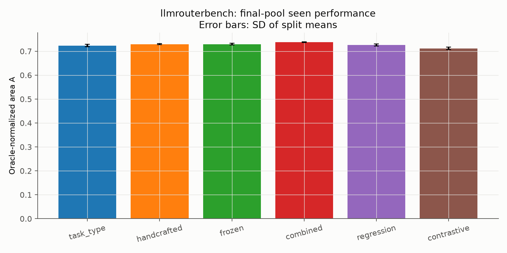

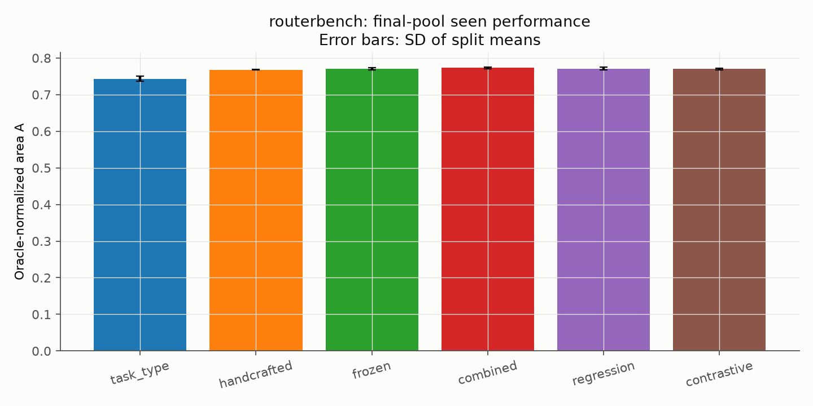

### 5.2 Unseen setting (a new model with n probes)

Seen gain on the final pool against the unseen gain (mean over every release instance, 3 splits, 3 training seeds, 3 probe seeds) at three probe budgets, with the rank of each representation per column; recovery is the unseen gain divided by the seen gain of the same instance pool, averaged over instances.

| benchmark | representation | seen gain (rank) | unseen gain, n=5 (rank) | unseen gain, n=50 (rank) | unseen gain, n=500 (rank) | recovery n=5 | recovery n=50 | recovery n=500 |
|---|---|---|---|---|---|---|---|---|
| llmrouterbench | combined | +6.18% (1) | +1.09% (1) | +1.24% (1) | +2.91% (1) | 0.21 | 0.24 | 0.54 |
| llmrouterbench | handcrafted | +4.91% (2) | +0.51% (3) | +0.63% (3) | +2.26% (2) | 0.12 | 0.15 | 0.50 |
| llmrouterbench | frozen | +4.86% (3) | +0.88% (2) | +1.16% (2) | +1.96% (4) | 0.19 | 0.25 | 0.44 |
| llmrouterbench | regression | +4.47% (4) | -0.05% (5) | -0.31% (5) | +2.25% (3) | -0.00 | -0.06 | 0.61 |
| llmrouterbench | task_type | +4.05% (5) | +0.16% (4) | +0.51% (4) | +0.95% (5) | 0.05 | 0.14 | 0.27 |
| llmrouterbench | contrastive | +2.38% (6) | -2.25% (6) | -2.81% (6) | -0.78% (6) | -1.02 | -1.24 | -0.39 |
| routerbench | combined | +7.98% (1) | -0.34% (2) | +2.25% (1) | +2.58% (2) | -0.27 | 0.51 | 0.61 |
| routerbench | regression | +7.71% (2) | -0.57% (5) | +1.46% (5) | +2.10% (4) | -0.34 | 0.32 | 0.53 |
| routerbench | frozen | +7.64% (3) | -0.46% (3) | +2.08% (2) | +2.58% (1) | -0.32 | 0.52 | 0.64 |
| routerbench | contrastive | +7.60% (4) | +0.05% (1) | +1.73% (4) | +2.05% (5) | -0.09 | 0.46 | 0.57 |
| routerbench | handcrafted | +7.29% (5) | -0.46% (4) | +1.90% (3) | +2.28% (3) | -0.30 | 0.47 | 0.60 |
| routerbench | task_type | +3.83% (6) | -3.17% (6) | +1.03% (6) | +1.32% (6) | -1.72 | 0.46 | 0.55 |

A at 500 probes, every release instance of llmrouterbench (mean over seeds; compare within a row, pools differ):

| instance | new model | combined | contrastive | frozen | handcrafted | regression | task_type |
|---|---|---|---|---|---|---|---|
| 0 | claude-sonnet-4 | 0.8793 | 0.8772 | 0.8788 | 0.8813 | 0.8790 | 0.8822 |
| 1 | deepseek-r1-0528 | 0.8260 | 0.8161 | 0.8183 | 0.8270 | 0.8231 | 0.8270 |
| 2 | gemini-2.5-flash | 0.7782 | 0.7672 | 0.7759 | 0.7758 | 0.7774 | 0.7761 |
| 3 | gemini-2.5-pro | 0.7954 | 0.7750 | 0.7968 | 0.7909 | 0.7796 | 0.7793 |
| 4 | qwen3-235b-a22b-2507 | 0.7650 | 0.7513 | 0.7653 | 0.7608 | 0.7582 | 0.7607 |
| 5 | qwen3-235b-a22b-thinking-2507 | 0.7546 | 0.7398 | 0.7512 | 0.7478 | 0.7569 | 0.7453 |
| 6 | intern-s1 | 0.7659 | 0.7202 | 0.7475 | 0.7598 | 0.7587 | 0.7386 |
| 7 | gpt-5-chat | 0.7374 | 0.7130 | 0.7304 | 0.7319 | 0.7392 | 0.7168 |
| 8 | gpt-5 | 0.7561 | 0.7314 | 0.7467 | 0.7491 | 0.7453 | 0.7434 |
| 9 | kimi-k2-0905 | 0.7324 | 0.6915 | 0.7222 | 0.7254 | 0.7290 | 0.7040 |
| 10 | deepseek-v3.1-terminus | 0.7339 | 0.6684 | 0.7221 | 0.7274 | 0.7275 | 0.7047 |
| 11 | glm-4.6 | 0.7328 | 0.6868 | 0.7198 | 0.7237 | 0.7250 | 0.7110 |

A at 500 probes, every release instance of routerbench (mean over seeds; compare within a row, pools differ):

| instance | new model | combined | contrastive | frozen | handcrafted | regression | task_type |
|---|---|---|---|---|---|---|---|
| 0 | claude-v2 | 0.8478 | 0.8441 | 0.8477 | 0.8484 | 0.8479 | 0.8397 |
| 1 | meta/llama-2-70b-chat | 0.8484 | 0.8433 | 0.8449 | 0.8466 | 0.8332 | 0.8438 |
| 2 | WizardLM/WizardLM-13B-V1.2 | 0.7990 | 0.7962 | 0.7969 | 0.7972 | 0.7977 | 0.7867 |
| 3 | meta/code-llama-instruct-34b-chat | 0.7626 | 0.7588 | 0.7608 | 0.7608 | 0.7608 | 0.7492 |
| 4 | mistralai/mistral-7b-chat | 0.7163 | 0.7128 | 0.7155 | 0.7139 | 0.7137 | 0.7047 |
| 5 | gpt-3.5-turbo-1106 | 0.6935 | 0.6920 | 0.6949 | 0.6944 | 0.6939 | 0.6979 |
| 6 | gpt-4-1106-preview | 0.7381 | 0.7340 | 0.7370 | 0.7353 | 0.7346 | 0.7275 |
| 7 | zero-one-ai/Yi-34B-Chat | 0.7430 | 0.7348 | 0.7473 | 0.7379 | 0.7305 | 0.7427 |
| 8 | mistralai/mixtral-8x7b-chat | 0.7560 | 0.7532 | 0.7590 | 0.7503 | 0.7592 | 0.7283 |

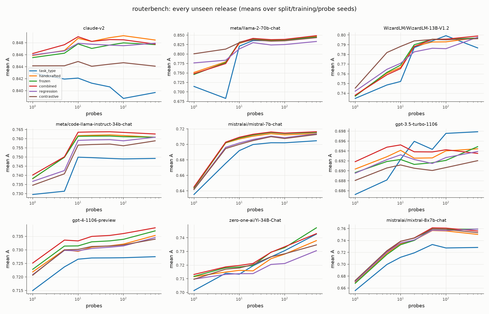

`handcrafted`, every model held out in turn from the full pool (3 splits × 5 probe seeds; mean over held-out models). `gain (same probes)` is over the single best that knows the new model only from the same n probes.

| benchmark | n probes | gain | gain (same probes) | recovery | A |
|---|---|---|---|---|---|
| llmrouterbench | 1 | -0.25% | +2.80% | -0.05 | 0.6939 |
| llmrouterbench | 2 | +2.39% | +3.18% | 0.51 | 0.7122 |
| llmrouterbench | 5 | +2.60% | +3.99% | 0.55 | 0.7136 |
| llmrouterbench | 10 | +1.09% | +3.14% | 0.23 | 0.7031 |
| llmrouterbench | 20 | +2.59% | +3.27% | 0.54 | 0.7136 |
| llmrouterbench | 50 | +3.07% | +3.32% | 0.64 | 0.7169 |
| llmrouterbench | 100 | +2.99% | +3.42% | 0.62 | 0.7164 |
| llmrouterbench | 500 | +3.81% | +3.85% | 0.80 | 0.7221 |
| routerbench | 1 | +0.35% | +6.45% | 0.04 | 0.7184 |
| routerbench | 2 | +3.53% | +6.93% | 0.47 | 0.7411 |
| routerbench | 5 | +4.88% | +7.16% | 0.66 | 0.7508 |
| routerbench | 10 | +5.36% | +7.28% | 0.72 | 0.7543 |
| routerbench | 20 | +5.82% | +6.74% | 0.78 | 0.7576 |
| routerbench | 50 | +6.23% | +6.38% | 0.84 | 0.7605 |
| routerbench | 100 | +6.27% | +6.34% | 0.85 | 0.7608 |
| routerbench | 500 | +6.33% | +6.34% | 0.85 | 0.7612 |

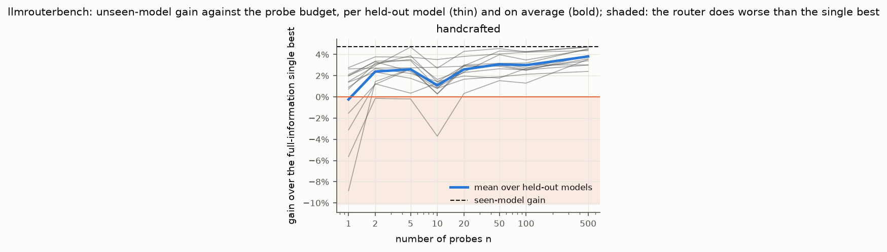

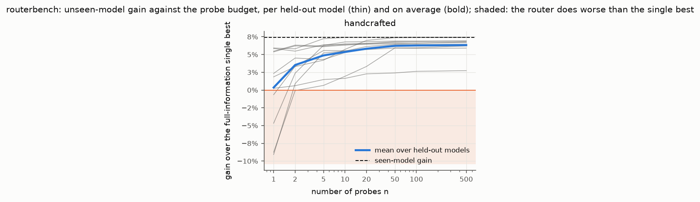

How well the 15 statistics alone identify the task type (train → test):

| benchmark | label | classes | majority | logistic regression | kNN (k = 50) |
|---|---|---|---|---|---|
| llmrouterbench | theme | 9 | 35.9% | 79.1% | 78.6% |
| llmrouterbench | task_level1 | 11 | 37.0% | 71.0% | 69.9% |
| routerbench | theme | 12 | 38.5% | 99.3% | 95.7% |
| routerbench | task_level1 | 11 | 32.0% | 76.9% | 80.5% |

### 5.3 Unified comparison with our Level-1/Level-2 labels (all representations, same protocol)

Final pool, seen setting; splits [0, 1, 2], training seeds [0, 1, 2].

| benchmark | representation | gain ± sd over splits | bootstrap 95% half-width | A | runs |
|---|---|---|---|---|---|
| llmrouterbench | handcrafted_nik | +4.86% ± 0.73% | ± 1.33% | 0.7294 | 3 |
| llmrouterbench | task_type_theme | +4.77% ± 0.85% | ± 1.28% | 0.7287 | 3 |
| llmrouterbench | handcrafted | +4.73% ± 0.33% | ± 1.29% | 0.7285 | 3 |
| llmrouterbench | regression_hc | +4.61% ± 0.76% | ± 1.33% | 0.7276 | 9 |
| llmrouterbench | combined | +4.58% ± 0.49% | ± 1.26% | 0.7275 | 3 |
| llmrouterbench | stats | +4.42% ± 0.39% | ± 1.17% | 0.7263 | 3 |
| llmrouterbench | task_type_L12 | +4.21% ± 0.48% | ± 1.40% | 0.7249 | 3 |
| llmrouterbench | regression | +4.17% ± 0.77% | ± 1.26% | 0.7245 | 9 |
| llmrouterbench | frozen | +4.07% ± 0.63% | ± 1.04% | 0.7239 | 3 |
| llmrouterbench | task_type_L1 | +3.94% ± 0.06% | ± 1.26% | 0.7230 | 3 |
| llmrouterbench | task_type_L2 | +3.69% ± 0.21% | ± 1.12% | 0.7213 | 3 |
| llmrouterbench | contrastive_hc | +3.09% ± 0.23% | ± 1.26% | 0.7171 | 9 |
| llmrouterbench | contrastive | +1.95% ± 0.27% | ± 1.06% | 0.7092 | 9 |
| routerbench | regression_hc | +8.02% ± 0.29% | ± 0.80% | 0.7733 | 9 |
| routerbench | contrastive_hc | +7.85% ± 0.31% | ± 0.80% | 0.7721 | 9 |
| routerbench | regression | +7.82% ± 0.27% | ± 0.82% | 0.7719 | 9 |
| routerbench | combined | +7.77% ± 0.41% | ± 0.79% | 0.7715 | 3 |
| routerbench | contrastive | +7.51% ± 0.24% | ± 0.78% | 0.7697 | 9 |
| routerbench | handcrafted | +7.41% ± 0.28% | ± 0.80% | 0.7690 | 3 |
| routerbench | handcrafted_nik | +7.17% ± 0.48% | ± 0.80% | 0.7673 | 3 |
| routerbench | frozen | +7.10% ± 0.28% | ± 0.82% | 0.7667 | 3 |
| routerbench | stats | +7.07% ± 0.30% | ± 0.77% | 0.7666 | 3 |
| routerbench | task_type_theme | +3.85% ± 0.42% | ± 0.52% | 0.7435 | 3 |
| routerbench | task_type_L2 | +3.67% ± 1.07% | ± 0.74% | 0.7422 | 3 |
| routerbench | task_type_L12 | +3.43% ± 0.94% | ± 0.72% | 0.7405 | 3 |
| routerbench | task_type_L1 | +2.62% ± 0.33% | ± 0.66% | 0.7347 | 3 |

Seen against unseen, every release instance run so far:

| benchmark | representation | seen gain (rank) | unseen gain, n=5 (rank) | unseen gain, n=50 (rank) | unseen gain, n=500 (rank) | recovery n=5 | recovery n=50 | recovery n=500 |
|---|---|---|---|---|---|---|---|---|
| llmrouterbench | handcrafted_nik | +4.86% (1) | +0.48% (6) | +0.62% (6) | +1.04% (6) | 0.12 | 0.15 | 0.24 |
| llmrouterbench | task_type_theme | +4.77% (2) | +0.59% (5) | +1.21% (5) | +1.34% (5) | 0.14 | 0.30 | 0.33 |
| llmrouterbench | handcrafted | +4.73% (3) | +1.11% (2) | +1.65% (3) | +2.10% (3) | 0.26 | 0.39 | 0.50 |
| llmrouterbench | regression_hc | +4.61% (4) | -0.22% (9) | -0.52% (9) | -0.37% (9) | -0.04 | -0.11 | -0.07 |
| llmrouterbench | combined | +4.58% (5) | +1.13% (1) | +1.80% (1) | +2.22% (2) | 0.27 | 0.44 | 0.55 |
| llmrouterbench | stats | +4.42% (6) | +0.96% (3) | +1.74% (2) | +2.28% (1) | 0.24 | 0.47 | 0.60 |
| llmrouterbench | task_type_L12 | +4.21% (7) | +0.39% (7) | +0.53% (8) | +0.87% (7) | 0.09 | 0.13 | 0.22 |
| llmrouterbench | regression | +4.17% (8) | -0.38% (10) | -0.70% (10) | -0.60% (10) | -0.09 | -0.17 | -0.15 |
| llmrouterbench | frozen | +4.07% (9) | +0.82% (4) | +1.65% (4) | +2.07% (4) | 0.22 | 0.45 | 0.58 |
| llmrouterbench | task_type_L1 | +3.94% (10) | +0.24% (8) | +0.57% (7) | +0.80% (8) | 0.04 | 0.15 | 0.22 |
| llmrouterbench | task_type_L2 | +3.69% (11) | -0.53% (11) | -1.02% (11) | -0.88% (11) | -0.16 | -0.29 | -0.25 |
| llmrouterbench | contrastive_hc | +3.09% (12) | -2.08% (12) | -2.78% (12) | -2.75% (12) | -0.65 | -0.86 | -0.84 |
| llmrouterbench | contrastive | +1.95% (13) | -2.24% (13) | -2.85% (13) | -2.84% (13) | -1.05 | -1.32 | -1.31 |
| routerbench | regression_hc | +8.02% (1) | -0.35% (8) | +1.71% (8) | +1.70% (8) | -0.26 | 0.35 | 0.34 |
| routerbench | contrastive_hc | +7.85% (2) | +0.24% (2) | +1.84% (7) | +1.77% (7) | -0.00 | 0.46 | 0.44 |
| routerbench | regression | +7.82% (3) | -0.39% (9) | +1.67% (9) | +1.67% (9) | -0.27 | 0.36 | 0.36 |
| routerbench | combined | +7.77% (4) | +0.00% (5) | +2.65% (1) | +2.65% (2) | -0.13 | 0.66 | 0.66 |
| routerbench | contrastive | +7.51% (5) | +0.34% (1) | +1.99% (6) | +1.92% (6) | 0.05 | 0.54 | 0.52 |
| routerbench | handcrafted | +7.41% (6) | +0.05% (4) | +2.61% (2) | +2.68% (1) | -0.10 | 0.65 | 0.66 |
| routerbench | handcrafted_nik | +7.17% (7) | -0.13% (6) | +2.49% (3) | +2.60% (3) | -0.19 | 0.63 | 0.64 |
| routerbench | frozen | +7.10% (8) | -0.40% (10) | +2.42% (5) | +2.46% (5) | -0.28 | 0.67 | 0.68 |
| routerbench | stats | +7.07% (9) | +0.08% (3) | +2.46% (4) | +2.51% (4) | -0.08 | 0.64 | 0.65 |
| routerbench | task_type_theme | +3.85% (10) | -1.66% (13) | +1.46% (12) | +1.49% (12) | -0.73 | 0.61 | 0.62 |
| routerbench | task_type_L2 | +3.67% (11) | -0.31% (7) | +1.53% (10) | +1.66% (10) | -0.08 | 0.62 | 0.66 |
| routerbench | task_type_L12 | +3.43% (12) | -0.57% (12) | +1.50% (11) | +1.66% (11) | -0.19 | 0.63 | 0.67 |
| routerbench | task_type_L1 | +2.62% (13) | -0.48% (11) | +0.99% (13) | +1.21% (13) | -0.13 | 0.54 | 0.63 |

Task-type recovery per level, A(task-type one-hot) / A(learned), final pool:

| benchmark | task-type variant | learned | recovery | sd | runs |
|---|---|---|---|---|---|
| llmrouterbench | task_type_L1 | regression | 0.9979 | 0.0095 | 3 |
| routerbench | task_type_L1 | regression | 0.9522 | 0.0041 | 3 |
| llmrouterbench | task_type_L1 | contrastive | 1.0198 | 0.0020 | 3 |
| routerbench | task_type_L1 | contrastive | 0.9543 | 0.0036 | 3 |
| llmrouterbench | task_type_L1 | regression_hc | 0.9930 | 0.0089 | 3 |
| routerbench | task_type_L1 | regression_hc | 0.9504 | 0.0029 | 3 |
| llmrouterbench | task_type_L1 | contrastive_hc | 1.0065 | 0.0023 | 3 |
| routerbench | task_type_L1 | contrastive_hc | 0.9511 | 0.0034 | 3 |
| llmrouterbench | task_type_L12 | regression | 1.0005 | 0.0088 | 3 |
| routerbench | task_type_L12 | regression | 0.9597 | 0.0093 | 3 |
| llmrouterbench | task_type_L12 | contrastive | 1.0225 | 0.0026 | 3 |
| routerbench | task_type_L12 | contrastive | 0.9619 | 0.0099 | 3 |
| llmrouterbench | task_type_L12 | regression_hc | 0.9957 | 0.0082 | 3 |
| routerbench | task_type_L12 | regression_hc | 0.9579 | 0.0109 | 3 |
| llmrouterbench | task_type_L12 | contrastive_hc | 1.0092 | 0.0059 | 3 |
| routerbench | task_type_L12 | contrastive_hc | 0.9586 | 0.0102 | 3 |
| llmrouterbench | task_type_L2 | regression | 0.9955 | 0.0086 | 3 |
| routerbench | task_type_L2 | regression | 0.9619 | 0.0100 | 3 |
| llmrouterbench | task_type_L2 | contrastive | 1.0173 | 0.0006 | 3 |
| routerbench | task_type_L2 | contrastive | 0.9641 | 0.0106 | 3 |
| llmrouterbench | task_type_L2 | regression_hc | 0.9907 | 0.0080 | 3 |
| routerbench | task_type_L2 | regression_hc | 0.9601 | 0.0117 | 3 |
| llmrouterbench | task_type_L2 | contrastive_hc | 1.0041 | 0.0031 | 3 |
| routerbench | task_type_L2 | contrastive_hc | 0.9608 | 0.0109 | 3 |
| llmrouterbench | task_type_theme | regression | 1.0058 | 0.0069 | 3 |
| routerbench | task_type_theme | regression | 0.9636 | 0.0031 | 3 |
| llmrouterbench | task_type_theme | contrastive | 1.0279 | 0.0058 | 3 |
| routerbench | task_type_theme | contrastive | 0.9658 | 0.0038 | 3 |
| llmrouterbench | task_type_theme | regression_hc | 1.0009 | 0.0066 | 3 |
| routerbench | task_type_theme | regression_hc | 0.9618 | 0.0049 | 3 |
| llmrouterbench | task_type_theme | contrastive_hc | 1.0145 | 0.0088 | 3 |
| routerbench | task_type_theme | contrastive_hc | 0.9625 | 0.0041 | 3 |

### 5.4 Paired comparisons

Paired bootstrap over the test queries, final pool, seen setting: difference of gains on the same split, mean ± sd over splits; `wins` = splits where a > b; `CI excl. 0` = splits whose 95% paired interval excludes zero; p = median two-sided bootstrap p over splits.

| benchmark | a − b | Δ gain | wins | CI excl. 0 | median p |
|---|---|---|---|---|---|
| llmrouterbench | handcrafted_nik − handcrafted | +0.13% ± 0.41% | 2 / 3 | 0 / 3 | 0.474 |
| llmrouterbench | task_type_theme − handcrafted | +0.04% ± 0.52% | 2 / 3 | 0 / 3 | 0.178 |
| llmrouterbench | regression_hc − handcrafted | -0.06% ± 0.75% | 1 / 3 | 0 / 3 | 0.094 |
| llmrouterbench | combined − handcrafted | -0.15% ± 0.17% | 0 / 3 | 0 / 3 | 0.914 |
| llmrouterbench | stats − handcrafted | -0.32% ± 0.07% | 0 / 3 | 0 / 3 | 0.420 |
| llmrouterbench | task_type_L12 − handcrafted | -0.52% ± 0.22% | 0 / 3 | 1 / 3 | 0.124 |
| llmrouterbench | regression − handcrafted | -0.56% ± 0.81% | 1 / 3 | 1 / 3 | 0.182 |
| llmrouterbench | frozen − handcrafted | -0.66% ± 0.31% | 0 / 3 | 1 / 3 | 0.224 |
| llmrouterbench | task_type_L1 − handcrafted | -0.79% ± 0.27% | 0 / 3 | 2 / 3 | 0.014 |
| llmrouterbench | task_type_L2 − handcrafted | -1.04% ± 0.12% | 0 / 3 | 3 / 3 | 0.014 |
| llmrouterbench | contrastive_hc − handcrafted | -1.47% ± 0.40% | 0 / 3 | 1 / 3 | 0.066 |
| llmrouterbench | contrastive − handcrafted | -2.81% ± 0.07% | 0 / 3 | 3 / 3 | 0.000 |
| routerbench | regression_hc − handcrafted | +0.57% ± 0.05% | 3 / 3 | 3 / 3 | 0.002 |
| routerbench | contrastive_hc − handcrafted | +0.50% ± 0.05% | 3 / 3 | 3 / 3 | 0.012 |
| routerbench | regression − handcrafted | +0.37% ± 0.15% | 3 / 3 | 1 / 3 | 0.058 |
| routerbench | combined − handcrafted | +0.36% ± 0.27% | 3 / 3 | 1 / 3 | 0.108 |
| routerbench | contrastive − handcrafted | +0.13% ± 0.08% | 3 / 3 | 0 / 3 | 0.444 |
| routerbench | handcrafted_nik − handcrafted | -0.24% ± 0.20% | 1 / 3 | 1 / 3 | 0.224 |
| routerbench | frozen − handcrafted | -0.31% ± 0.04% | 0 / 3 | 0 / 3 | 0.188 |
| routerbench | stats − handcrafted | -0.33% ± 0.03% | 0 / 3 | 0 / 3 | 0.102 |
| routerbench | task_type_theme − handcrafted | -3.55% ± 0.48% | 0 / 3 | 3 / 3 | 0.000 |
| routerbench | task_type_L2 − handcrafted | -3.73% ± 1.22% | 0 / 3 | 3 / 3 | 0.000 |
| routerbench | task_type_L12 − handcrafted | -3.98% ± 1.14% | 0 / 3 | 3 / 3 | 0.000 |
| routerbench | task_type_L1 − handcrafted | -4.78% ± 0.33% | 0 / 3 | 3 / 3 | 0.000 |

Unseen setting (over instances × splits):

| benchmark | n probes | a − b | Δ gain | wins | CI excl. 0 |
|---|---|---|---|---|---|
| llmrouterbench | 5 | combined − handcrafted | -0.01% | 17 / 36 | 3 / 36 |
| llmrouterbench | 5 | stats − handcrafted | -0.13% | 11 / 36 | 2 / 36 |
| llmrouterbench | 5 | frozen − handcrafted | -0.35% | 6 / 36 | 8 / 36 |
| llmrouterbench | 5 | task_type_L12 − handcrafted | -0.95% | 7 / 36 | 23 / 36 |
| llmrouterbench | 5 | handcrafted_nik − handcrafted | -0.95% | 9 / 36 | 21 / 36 |
| llmrouterbench | 5 | task_type_theme − handcrafted | -0.96% | 10 / 36 | 21 / 36 |
| llmrouterbench | 5 | task_type_L1 − handcrafted | -1.18% | 6 / 36 | 25 / 36 |
| llmrouterbench | 5 | regression_hc − handcrafted | -1.92% | 7 / 36 | 20 / 36 |
| llmrouterbench | 5 | regression − handcrafted | -2.18% | 8 / 36 | 24 / 36 |
| llmrouterbench | 5 | task_type_L2 − handcrafted | -2.20% | 7 / 36 | 26 / 36 |
| llmrouterbench | 5 | contrastive − handcrafted | -3.93% | 5 / 36 | 26 / 36 |
| llmrouterbench | 5 | contrastive_hc − handcrafted | -3.95% | 5 / 36 | 25 / 36 |
| llmrouterbench | 50 | combined − handcrafted | +0.16% | 23 / 36 | 5 / 36 |
| llmrouterbench | 50 | stats − handcrafted | +0.10% | 16 / 36 | 8 / 36 |
| llmrouterbench | 50 | frozen − handcrafted | +0.05% | 19 / 36 | 9 / 36 |
| llmrouterbench | 50 | task_type_theme − handcrafted | -0.30% | 13 / 36 | 17 / 36 |
| llmrouterbench | 50 | handcrafted_nik − handcrafted | -1.04% | 6 / 36 | 21 / 36 |
| llmrouterbench | 50 | task_type_L1 − handcrafted | -1.06% | 5 / 36 | 22 / 36 |
| llmrouterbench | 50 | task_type_L12 − handcrafted | -1.12% | 7 / 36 | 22 / 36 |
| llmrouterbench | 50 | regression_hc − handcrafted | -2.06% | 6 / 36 | 23 / 36 |
| llmrouterbench | 50 | regression − handcrafted | -2.44% | 4 / 36 | 26 / 36 |
| llmrouterbench | 50 | task_type_L2 − handcrafted | -2.69% | 5 / 36 | 28 / 36 |
| llmrouterbench | 50 | contrastive − handcrafted | -4.40% | 3 / 36 | 29 / 36 |
| llmrouterbench | 50 | contrastive_hc − handcrafted | -4.42% | 3 / 36 | 29 / 36 |
| llmrouterbench | 500 | stats − handcrafted | +0.16% | 20 / 36 | 7 / 36 |
| llmrouterbench | 500 | combined − handcrafted | +0.11% | 21 / 36 | 3 / 36 |
| llmrouterbench | 500 | frozen − handcrafted | -0.11% | 16 / 36 | 4 / 36 |
| llmrouterbench | 500 | task_type_theme − handcrafted | -0.83% | 6 / 36 | 16 / 36 |
| llmrouterbench | 500 | handcrafted_nik − handcrafted | -1.14% | 7 / 36 | 25 / 36 |
| llmrouterbench | 500 | task_type_L12 − handcrafted | -1.26% | 6 / 36 | 28 / 36 |
| llmrouterbench | 500 | task_type_L1 − handcrafted | -1.37% | 5 / 36 | 26 / 36 |
| llmrouterbench | 500 | regression_hc − handcrafted | -2.52% | 4 / 36 | 28 / 36 |
| llmrouterbench | 500 | regression − handcrafted | -2.94% | 3 / 36 | 28 / 36 |
| llmrouterbench | 500 | task_type_L2 − handcrafted | -3.01% | 6 / 36 | 30 / 36 |
| llmrouterbench | 500 | contrastive_hc − handcrafted | -4.99% | 4 / 36 | 30 / 36 |
| llmrouterbench | 500 | contrastive − handcrafted | -5.02% | 3 / 36 | 31 / 36 |
| routerbench | 5 | contrastive − handcrafted | +0.85% | 8 / 27 | 16 / 27 |
| routerbench | 5 | contrastive_hc − handcrafted | +0.66% | 12 / 27 | 17 / 27 |
| routerbench | 5 | task_type_L1 − handcrafted | +0.14% | 8 / 27 | 21 / 27 |
| routerbench | 5 | stats − handcrafted | +0.06% | 8 / 27 | 10 / 27 |
| routerbench | 5 | task_type_L2 − handcrafted | +0.04% | 6 / 27 | 20 / 27 |
| routerbench | 5 | combined − handcrafted | -0.15% | 15 / 27 | 9 / 27 |
| routerbench | 5 | regression_hc − handcrafted | -0.24% | 10 / 27 | 14 / 27 |
| routerbench | 5 | regression − handcrafted | -0.24% | 12 / 27 | 15 / 27 |
| routerbench | 5 | handcrafted_nik − handcrafted | -0.27% | 8 / 27 | 12 / 27 |
| routerbench | 5 | task_type_L12 − handcrafted | -0.53% | 6 / 27 | 22 / 27 |
| routerbench | 5 | frozen − handcrafted | -0.86% | 6 / 27 | 10 / 27 |
| routerbench | 5 | task_type_theme − handcrafted | -2.91% | 2 / 27 | 20 / 27 |
| routerbench | 50 | combined − handcrafted | +0.01% | 15 / 27 | 6 / 27 |
| routerbench | 50 | handcrafted_nik − handcrafted | -0.12% | 8 / 27 | 6 / 27 |
| routerbench | 50 | stats − handcrafted | -0.15% | 4 / 27 | 3 / 27 |
| routerbench | 50 | frozen − handcrafted | -0.18% | 7 / 27 | 4 / 27 |
| routerbench | 50 | contrastive − handcrafted | -0.63% | 0 / 27 | 13 / 27 |
| routerbench | 50 | contrastive_hc − handcrafted | -0.82% | 2 / 27 | 16 / 27 |
| routerbench | 50 | regression_hc − handcrafted | -0.93% | 3 / 27 | 17 / 27 |
| routerbench | 50 | regression − handcrafted | -0.97% | 4 / 27 | 15 / 27 |
| routerbench | 50 | task_type_L12 − handcrafted | -1.04% | 2 / 27 | 20 / 27 |
| routerbench | 50 | task_type_L2 − handcrafted | -1.07% | 2 / 27 | 19 / 27 |
| routerbench | 50 | task_type_theme − handcrafted | -1.10% | 1 / 27 | 17 / 27 |
| routerbench | 50 | task_type_L1 − handcrafted | -1.57% | 1 / 27 | 20 / 27 |
| routerbench | 500 | combined − handcrafted | -0.05% | 13 / 27 | 4 / 27 |
| routerbench | 500 | handcrafted_nik − handcrafted | -0.08% | 12 / 27 | 7 / 27 |
| routerbench | 500 | stats − handcrafted | -0.17% | 8 / 27 | 6 / 27 |
| routerbench | 500 | frozen − handcrafted | -0.23% | 5 / 27 | 5 / 27 |
| routerbench | 500 | contrastive − handcrafted | -0.73% | 0 / 27 | 16 / 27 |
| routerbench | 500 | contrastive_hc − handcrafted | -0.91% | 2 / 27 | 20 / 27 |
| routerbench | 500 | regression_hc − handcrafted | -0.99% | 2 / 27 | 17 / 27 |
| routerbench | 500 | regression − handcrafted | -1.00% | 3 / 27 | 15 / 27 |
| routerbench | 500 | task_type_L2 − handcrafted | -1.03% | 3 / 27 | 20 / 27 |
| routerbench | 500 | task_type_L12 − handcrafted | -1.04% | 2 / 27 | 20 / 27 |
| routerbench | 500 | task_type_theme − handcrafted | -1.14% | 3 / 27 | 20 / 27 |
| routerbench | 500 | task_type_L1 − handcrafted | -1.46% | 2 / 27 | 17 / 27 |

### 5.5 Embedding structure: PCA, t-SNE and label purity

Is a representation "just the task type"? Share of a test query's 10 nearest training neighbours with the same label (what the router averages over), a linear probe's test accuracy, and the silhouette of the labels:

| benchmark | representation | label | classes | majority | kNN purity | linear probe | silhouette |
|---|---|---|---|---|---|---|---|
| llmrouterbench | task_type_L1 | task_level1 | 11 | 36.7% | 100.0% | 100.0% | 0.999 |
| llmrouterbench | task_type_L12 | task_level1 | 11 | 36.7% | 100.0% | 100.0% | 0.480 |
| llmrouterbench | handcrafted | task_level1 | 11 | 36.7% | 99.8% | 100.0% | 0.272 |
| llmrouterbench | combined | task_level1 | 11 | 36.7% | 99.3% | 99.9% | 0.125 |
| llmrouterbench | task_type_L2 | task_level1 | 11 | 36.7% | 96.4% | 99.2% | 0.261 |
| llmrouterbench | frozen | task_level1 | 11 | 36.7% | 81.2% | 82.6% | 0.014 |
| llmrouterbench | regression_hc | task_level1 | 11 | 36.7% | 75.7% | 89.1% | -0.221 |
| llmrouterbench | contrastive_hc | task_level1 | 11 | 36.7% | 69.1% | 88.3% | -0.212 |
| llmrouterbench | handcrafted_nik | task_level1 | 11 | 36.7% | 68.2% | 70.8% | 0.094 |
| llmrouterbench | regression | task_level1 | 11 | 36.7% | 65.7% | 75.4% | -0.188 |
| llmrouterbench | stats | task_level1 | 11 | 36.7% | 65.2% | 71.0% | 0.023 |
| llmrouterbench | task_type_theme | task_level1 | 11 | 36.7% | 61.5% | 68.6% | 0.083 |
| llmrouterbench | contrastive | task_level1 | 11 | 36.7% | 53.5% | 72.3% | -0.151 |
| llmrouterbench | task_type_L2 | task_level2 | 85 | 9.9% | 99.4% | 100.0% | 0.996 |
| llmrouterbench | task_type_L12 | task_level2 | 85 | 9.9% | 99.1% | 100.0% | 0.973 |
| llmrouterbench | handcrafted | task_level2 | 85 | 9.9% | 97.5% | 100.0% | 0.412 |
| llmrouterbench | combined | task_level2 | 85 | 9.9% | 94.8% | 100.0% | 0.127 |
| llmrouterbench | frozen | task_level2 | 85 | 9.9% | 54.6% | 63.2% | 0.007 |
| llmrouterbench | contrastive_hc | task_level2 | 85 | 9.9% | 52.0% | 89.8% | -0.212 |
| llmrouterbench | regression_hc | task_level2 | 85 | 9.9% | 50.0% | 85.3% | -0.341 |
| llmrouterbench | regression | task_level2 | 85 | 9.9% | 34.2% | 52.1% | -0.341 |
| llmrouterbench | stats | task_level2 | 85 | 9.9% | 30.1% | 39.6% | -0.233 |
| llmrouterbench | contrastive | task_level2 | 85 | 9.9% | 29.8% | 53.3% | -0.205 |
| llmrouterbench | handcrafted_nik | task_level2 | 85 | 9.9% | 27.3% | 32.4% | -0.612 |
| llmrouterbench | task_type_theme | task_level2 | 85 | 9.9% | 22.9% | 29.6% | -0.711 |
| llmrouterbench | task_type_L1 | task_level2 | 85 | 9.9% | 20.5% | 37.3% | -0.184 |
| llmrouterbench | task_type_theme | theme | 9 | 35.8% | 100.0% | 100.0% | 1.000 |
| llmrouterbench | handcrafted_nik | theme | 9 | 35.8% | 100.0% | 100.0% | 0.874 |
| llmrouterbench | combined | theme | 9 | 35.8% | 86.1% | 90.0% | 0.093 |
| llmrouterbench | handcrafted | theme | 9 | 35.8% | 84.4% | 88.8% | 0.174 |
| llmrouterbench | regression_hc | theme | 9 | 35.8% | 83.1% | 87.7% | 0.023 |
| llmrouterbench | frozen | theme | 9 | 35.8% | 79.5% | 86.5% | 0.026 |
| llmrouterbench | contrastive_hc | theme | 9 | 35.8% | 77.0% | 86.3% | -0.044 |
| llmrouterbench | regression | theme | 9 | 35.8% | 76.1% | 82.4% | 0.016 |
| llmrouterbench | stats | theme | 9 | 35.8% | 74.0% | 79.2% | 0.131 |
| llmrouterbench | contrastive | theme | 9 | 35.8% | 65.4% | 79.5% | -0.089 |
| llmrouterbench | task_type_L12 | theme | 9 | 35.8% | 28.6% | 82.3% | 0.183 |
| llmrouterbench | task_type_L2 | theme | 9 | 35.8% | 27.9% | 82.3% | 0.159 |
| llmrouterbench | task_type_L1 | theme | 9 | 35.8% | 9.1% | 76.6% | 0.189 |
| routerbench | task_type_L1 | task_level1 | 11 | 31.9% | 100.0% | 100.0% | 1.000 |
| routerbench | task_type_L12 | task_level1 | 11 | 31.9% | 100.0% | 100.0% | 0.673 |
| routerbench | handcrafted | task_level1 | 11 | 31.9% | 99.9% | 100.0% | 0.383 |
| routerbench | combined | task_level1 | 11 | 31.9% | 99.7% | 100.0% | 0.173 |
| routerbench | task_type_L2 | task_level1 | 11 | 31.9% | 97.4% | 98.0% | 0.534 |
| routerbench | contrastive_hc | task_level1 | 11 | 31.9% | 89.1% | 96.2% | 0.071 |
| routerbench | regression_hc | task_level1 | 11 | 31.9% | 88.3% | 97.5% | 0.144 |
| routerbench | frozen | task_level1 | 11 | 31.9% | 87.2% | 91.2% | 0.037 |
| routerbench | regression | task_level1 | 11 | 31.9% | 78.2% | 85.8% | 0.147 |
| routerbench | contrastive | task_level1 | 11 | 31.9% | 78.0% | 83.9% | 0.071 |
| routerbench | stats | task_level1 | 11 | 31.9% | 77.3% | 76.9% | 0.061 |
| routerbench | handcrafted_nik | task_level1 | 11 | 31.9% | 74.8% | 76.8% | 0.213 |
| routerbench | task_type_theme | task_level1 | 11 | 31.9% | 62.2% | 71.5% | 0.286 |
| routerbench | task_type_L2 | task_level2 | 83 | 27.6% | 99.9% | 100.0% | 0.997 |
| routerbench | task_type_L12 | task_level2 | 83 | 27.6% | 99.8% | 100.0% | 0.976 |
| routerbench | handcrafted | task_level2 | 83 | 27.6% | 99.5% | 100.0% | 0.456 |
| routerbench | combined | task_level2 | 83 | 27.6% | 99.0% | 100.0% | 0.155 |
| routerbench | contrastive_hc | task_level2 | 83 | 27.6% | 82.6% | 95.4% | 0.057 |
| routerbench | regression_hc | task_level2 | 83 | 27.6% | 79.8% | 96.4% | 0.059 |
| routerbench | frozen | task_level2 | 83 | 27.6% | 79.4% | 85.7% | -0.004 |
| routerbench | stats | task_level2 | 83 | 27.6% | 69.7% | 72.5% | -0.211 |
| routerbench | regression | task_level2 | 83 | 27.6% | 68.7% | 80.4% | -0.077 |
| routerbench | contrastive | task_level2 | 83 | 27.6% | 68.6% | 79.2% | -0.009 |
| routerbench | handcrafted_nik | task_level2 | 83 | 27.6% | 67.3% | 69.2% | -0.121 |
| routerbench | task_type_theme | task_level2 | 83 | 27.6% | 56.0% | 62.5% | -0.207 |
| routerbench | task_type_L1 | task_level2 | 83 | 27.6% | 33.0% | 66.8% | -0.106 |
| routerbench | handcrafted_nik | theme | 12 | 38.5% | 100.0% | 100.0% | 0.742 |
| routerbench | task_type_theme | theme | 12 | 38.5% | 100.0% | 100.0% | 1.000 |
| routerbench | contrastive_hc | theme | 12 | 38.5% | 98.2% | 98.9% | 0.197 |
| routerbench | regression_hc | theme | 12 | 38.5% | 97.9% | 98.7% | 0.204 |
| routerbench | handcrafted | theme | 12 | 38.5% | 97.7% | 99.6% | 0.315 |
| routerbench | combined | theme | 12 | 38.5% | 97.7% | 99.5% | 0.127 |
| routerbench | stats | theme | 12 | 38.5% | 95.8% | 99.3% | 0.107 |
| routerbench | regression | theme | 12 | 38.5% | 95.2% | 96.8% | 0.179 |
| routerbench | contrastive | theme | 12 | 38.5% | 94.8% | 96.9% | 0.156 |
| routerbench | frozen | theme | 12 | 38.5% | 91.6% | 98.5% | 0.019 |
| routerbench | task_type_L12 | theme | 12 | 38.5% | 37.6% | 95.1% | 0.503 |
| routerbench | task_type_L2 | theme | 12 | 38.5% | 37.4% | 95.1% | 0.522 |
| routerbench | task_type_L1 | theme | 12 | 38.5% | 15.9% | 86.0% | -0.105 |

Figures (PCA and t-SNE small multiples, one panel per category, the category in blue over all queries in gray):

- llmrouterbench, `combined`: [pca by task_level1](analysis_compare/views/llmrouterbench_combined_pca_task_level1.png), [pca by task_level2](analysis_compare/views/llmrouterbench_combined_pca_task_level2.png), [pca by theme](analysis_compare/views/llmrouterbench_combined_pca_theme.png), [tsne by task_level1](analysis_compare/views/llmrouterbench_combined_tsne_task_level1.png), [tsne by task_level2](analysis_compare/views/llmrouterbench_combined_tsne_task_level2.png), [tsne by theme](analysis_compare/views/llmrouterbench_combined_tsne_theme.png)
- llmrouterbench, `contrastive`: [pca by task_level1](analysis_compare/views/llmrouterbench_contrastive_pca_task_level1.png), [pca by task_level2](analysis_compare/views/llmrouterbench_contrastive_pca_task_level2.png), [pca by theme](analysis_compare/views/llmrouterbench_contrastive_pca_theme.png), [tsne by task_level1](analysis_compare/views/llmrouterbench_contrastive_tsne_task_level1.png), [tsne by task_level2](analysis_compare/views/llmrouterbench_contrastive_tsne_task_level2.png), [tsne by theme](analysis_compare/views/llmrouterbench_contrastive_tsne_theme.png)
- llmrouterbench, `contrastive_hc`: [pca by task_level1](analysis_compare/views/llmrouterbench_contrastive_hc_pca_task_level1.png), [pca by task_level2](analysis_compare/views/llmrouterbench_contrastive_hc_pca_task_level2.png), [pca by theme](analysis_compare/views/llmrouterbench_contrastive_hc_pca_theme.png), [tsne by task_level1](analysis_compare/views/llmrouterbench_contrastive_hc_tsne_task_level1.png), [tsne by task_level2](analysis_compare/views/llmrouterbench_contrastive_hc_tsne_task_level2.png), [tsne by theme](analysis_compare/views/llmrouterbench_contrastive_hc_tsne_theme.png)
- llmrouterbench, `frozen`: [pca by task_level1](analysis_compare/views/llmrouterbench_frozen_pca_task_level1.png), [pca by task_level2](analysis_compare/views/llmrouterbench_frozen_pca_task_level2.png), [pca by theme](analysis_compare/views/llmrouterbench_frozen_pca_theme.png), [tsne by task_level1](analysis_compare/views/llmrouterbench_frozen_tsne_task_level1.png), [tsne by task_level2](analysis_compare/views/llmrouterbench_frozen_tsne_task_level2.png), [tsne by theme](analysis_compare/views/llmrouterbench_frozen_tsne_theme.png)
- llmrouterbench, `handcrafted`: [pca by task_level1](analysis_compare/views/llmrouterbench_handcrafted_pca_task_level1.png), [pca by task_level2](analysis_compare/views/llmrouterbench_handcrafted_pca_task_level2.png), [pca by theme](analysis_compare/views/llmrouterbench_handcrafted_pca_theme.png), [tsne by task_level1](analysis_compare/views/llmrouterbench_handcrafted_tsne_task_level1.png), [tsne by task_level2](analysis_compare/views/llmrouterbench_handcrafted_tsne_task_level2.png), [tsne by theme](analysis_compare/views/llmrouterbench_handcrafted_tsne_theme.png)
- llmrouterbench, `handcrafted_nik`: [pca by task_level1](analysis_compare/views/llmrouterbench_handcrafted_nik_pca_task_level1.png), [pca by task_level2](analysis_compare/views/llmrouterbench_handcrafted_nik_pca_task_level2.png), [pca by theme](analysis_compare/views/llmrouterbench_handcrafted_nik_pca_theme.png), [tsne by task_level1](analysis_compare/views/llmrouterbench_handcrafted_nik_tsne_task_level1.png), [tsne by task_level2](analysis_compare/views/llmrouterbench_handcrafted_nik_tsne_task_level2.png), [tsne by theme](analysis_compare/views/llmrouterbench_handcrafted_nik_tsne_theme.png)
- llmrouterbench, `regression`: [pca by task_level1](analysis_compare/views/llmrouterbench_regression_pca_task_level1.png), [pca by task_level2](analysis_compare/views/llmrouterbench_regression_pca_task_level2.png), [pca by theme](analysis_compare/views/llmrouterbench_regression_pca_theme.png), [tsne by task_level1](analysis_compare/views/llmrouterbench_regression_tsne_task_level1.png), [tsne by task_level2](analysis_compare/views/llmrouterbench_regression_tsne_task_level2.png), [tsne by theme](analysis_compare/views/llmrouterbench_regression_tsne_theme.png)
- llmrouterbench, `regression_hc`: [pca by task_level1](analysis_compare/views/llmrouterbench_regression_hc_pca_task_level1.png), [pca by task_level2](analysis_compare/views/llmrouterbench_regression_hc_pca_task_level2.png), [pca by theme](analysis_compare/views/llmrouterbench_regression_hc_pca_theme.png), [tsne by task_level1](analysis_compare/views/llmrouterbench_regression_hc_tsne_task_level1.png), [tsne by task_level2](analysis_compare/views/llmrouterbench_regression_hc_tsne_task_level2.png), [tsne by theme](analysis_compare/views/llmrouterbench_regression_hc_tsne_theme.png)
- llmrouterbench, `stats`: [pca by task_level1](analysis_compare/views/llmrouterbench_stats_pca_task_level1.png), [pca by task_level2](analysis_compare/views/llmrouterbench_stats_pca_task_level2.png), [pca by theme](analysis_compare/views/llmrouterbench_stats_pca_theme.png), [tsne by task_level1](analysis_compare/views/llmrouterbench_stats_tsne_task_level1.png), [tsne by task_level2](analysis_compare/views/llmrouterbench_stats_tsne_task_level2.png), [tsne by theme](analysis_compare/views/llmrouterbench_stats_tsne_theme.png)
- llmrouterbench, `task_type_L1`: [pca by task_level1](analysis_compare/views/llmrouterbench_task_type_L1_pca_task_level1.png), [pca by task_level2](analysis_compare/views/llmrouterbench_task_type_L1_pca_task_level2.png), [pca by theme](analysis_compare/views/llmrouterbench_task_type_L1_pca_theme.png), [tsne by task_level1](analysis_compare/views/llmrouterbench_task_type_L1_tsne_task_level1.png), [tsne by task_level2](analysis_compare/views/llmrouterbench_task_type_L1_tsne_task_level2.png), [tsne by theme](analysis_compare/views/llmrouterbench_task_type_L1_tsne_theme.png)
- llmrouterbench, `task_type_L12`: [pca by task_level1](analysis_compare/views/llmrouterbench_task_type_L12_pca_task_level1.png), [pca by task_level2](analysis_compare/views/llmrouterbench_task_type_L12_pca_task_level2.png), [pca by theme](analysis_compare/views/llmrouterbench_task_type_L12_pca_theme.png), [tsne by task_level1](analysis_compare/views/llmrouterbench_task_type_L12_tsne_task_level1.png), [tsne by task_level2](analysis_compare/views/llmrouterbench_task_type_L12_tsne_task_level2.png), [tsne by theme](analysis_compare/views/llmrouterbench_task_type_L12_tsne_theme.png)
- llmrouterbench, `task_type_L2`: [pca by task_level1](analysis_compare/views/llmrouterbench_task_type_L2_pca_task_level1.png), [pca by task_level2](analysis_compare/views/llmrouterbench_task_type_L2_pca_task_level2.png), [pca by theme](analysis_compare/views/llmrouterbench_task_type_L2_pca_theme.png), [tsne by task_level1](analysis_compare/views/llmrouterbench_task_type_L2_tsne_task_level1.png), [tsne by task_level2](analysis_compare/views/llmrouterbench_task_type_L2_tsne_task_level2.png), [tsne by theme](analysis_compare/views/llmrouterbench_task_type_L2_tsne_theme.png)
- llmrouterbench, `task_type_theme`: [pca by task_level1](analysis_compare/views/llmrouterbench_task_type_theme_pca_task_level1.png), [pca by task_level2](analysis_compare/views/llmrouterbench_task_type_theme_pca_task_level2.png), [pca by theme](analysis_compare/views/llmrouterbench_task_type_theme_pca_theme.png), [tsne by task_level1](analysis_compare/views/llmrouterbench_task_type_theme_tsne_task_level1.png), [tsne by task_level2](analysis_compare/views/llmrouterbench_task_type_theme_tsne_task_level2.png), [tsne by theme](analysis_compare/views/llmrouterbench_task_type_theme_tsne_theme.png)
- routerbench, `combined`: [pca by task_level1](analysis_compare/views/routerbench_combined_pca_task_level1.png), [pca by task_level2](analysis_compare/views/routerbench_combined_pca_task_level2.png), [pca by theme](analysis_compare/views/routerbench_combined_pca_theme.png), [tsne by task_level1](analysis_compare/views/routerbench_combined_tsne_task_level1.png), [tsne by task_level2](analysis_compare/views/routerbench_combined_tsne_task_level2.png), [tsne by theme](analysis_compare/views/routerbench_combined_tsne_theme.png)
- routerbench, `contrastive`: [pca by task_level1](analysis_compare/views/routerbench_contrastive_pca_task_level1.png), [pca by task_level2](analysis_compare/views/routerbench_contrastive_pca_task_level2.png), [pca by theme](analysis_compare/views/routerbench_contrastive_pca_theme.png), [tsne by task_level1](analysis_compare/views/routerbench_contrastive_tsne_task_level1.png), [tsne by task_level2](analysis_compare/views/routerbench_contrastive_tsne_task_level2.png), [tsne by theme](analysis_compare/views/routerbench_contrastive_tsne_theme.png)
- routerbench, `contrastive_hc`: [pca by task_level1](analysis_compare/views/routerbench_contrastive_hc_pca_task_level1.png), [pca by task_level2](analysis_compare/views/routerbench_contrastive_hc_pca_task_level2.png), [pca by theme](analysis_compare/views/routerbench_contrastive_hc_pca_theme.png), [tsne by task_level1](analysis_compare/views/routerbench_contrastive_hc_tsne_task_level1.png), [tsne by task_level2](analysis_compare/views/routerbench_contrastive_hc_tsne_task_level2.png), [tsne by theme](analysis_compare/views/routerbench_contrastive_hc_tsne_theme.png)
- routerbench, `frozen`: [pca by task_level1](analysis_compare/views/routerbench_frozen_pca_task_level1.png), [pca by task_level2](analysis_compare/views/routerbench_frozen_pca_task_level2.png), [pca by theme](analysis_compare/views/routerbench_frozen_pca_theme.png), [tsne by task_level1](analysis_compare/views/routerbench_frozen_tsne_task_level1.png), [tsne by task_level2](analysis_compare/views/routerbench_frozen_tsne_task_level2.png), [tsne by theme](analysis_compare/views/routerbench_frozen_tsne_theme.png)
- routerbench, `handcrafted`: [pca by task_level1](analysis_compare/views/routerbench_handcrafted_pca_task_level1.png), [pca by task_level2](analysis_compare/views/routerbench_handcrafted_pca_task_level2.png), [pca by theme](analysis_compare/views/routerbench_handcrafted_pca_theme.png), [tsne by task_level1](analysis_compare/views/routerbench_handcrafted_tsne_task_level1.png), [tsne by task_level2](analysis_compare/views/routerbench_handcrafted_tsne_task_level2.png), [tsne by theme](analysis_compare/views/routerbench_handcrafted_tsne_theme.png)
- routerbench, `handcrafted_nik`: [pca by task_level1](analysis_compare/views/routerbench_handcrafted_nik_pca_task_level1.png), [pca by task_level2](analysis_compare/views/routerbench_handcrafted_nik_pca_task_level2.png), [pca by theme](analysis_compare/views/routerbench_handcrafted_nik_pca_theme.png), [tsne by task_level1](analysis_compare/views/routerbench_handcrafted_nik_tsne_task_level1.png), [tsne by task_level2](analysis_compare/views/routerbench_handcrafted_nik_tsne_task_level2.png), [tsne by theme](analysis_compare/views/routerbench_handcrafted_nik_tsne_theme.png)
- routerbench, `regression`: [pca by task_level1](analysis_compare/views/routerbench_regression_pca_task_level1.png), [pca by task_level2](analysis_compare/views/routerbench_regression_pca_task_level2.png), [pca by theme](analysis_compare/views/routerbench_regression_pca_theme.png), [tsne by task_level1](analysis_compare/views/routerbench_regression_tsne_task_level1.png), [tsne by task_level2](analysis_compare/views/routerbench_regression_tsne_task_level2.png), [tsne by theme](analysis_compare/views/routerbench_regression_tsne_theme.png)
- routerbench, `regression_hc`: [pca by task_level1](analysis_compare/views/routerbench_regression_hc_pca_task_level1.png), [pca by task_level2](analysis_compare/views/routerbench_regression_hc_pca_task_level2.png), [pca by theme](analysis_compare/views/routerbench_regression_hc_pca_theme.png), [tsne by task_level1](analysis_compare/views/routerbench_regression_hc_tsne_task_level1.png), [tsne by task_level2](analysis_compare/views/routerbench_regression_hc_tsne_task_level2.png), [tsne by theme](analysis_compare/views/routerbench_regression_hc_tsne_theme.png)
- routerbench, `stats`: [pca by task_level1](analysis_compare/views/routerbench_stats_pca_task_level1.png), [pca by task_level2](analysis_compare/views/routerbench_stats_pca_task_level2.png), [pca by theme](analysis_compare/views/routerbench_stats_pca_theme.png), [tsne by task_level1](analysis_compare/views/routerbench_stats_tsne_task_level1.png), [tsne by task_level2](analysis_compare/views/routerbench_stats_tsne_task_level2.png), [tsne by theme](analysis_compare/views/routerbench_stats_tsne_theme.png)
- routerbench, `task_type_L1`: [pca by task_level1](analysis_compare/views/routerbench_task_type_L1_pca_task_level1.png), [pca by task_level2](analysis_compare/views/routerbench_task_type_L1_pca_task_level2.png), [pca by theme](analysis_compare/views/routerbench_task_type_L1_pca_theme.png), [tsne by task_level1](analysis_compare/views/routerbench_task_type_L1_tsne_task_level1.png), [tsne by task_level2](analysis_compare/views/routerbench_task_type_L1_tsne_task_level2.png), [tsne by theme](analysis_compare/views/routerbench_task_type_L1_tsne_theme.png)
- routerbench, `task_type_L12`: [pca by task_level1](analysis_compare/views/routerbench_task_type_L12_pca_task_level1.png), [pca by task_level2](analysis_compare/views/routerbench_task_type_L12_pca_task_level2.png), [pca by theme](analysis_compare/views/routerbench_task_type_L12_pca_theme.png), [tsne by task_level1](analysis_compare/views/routerbench_task_type_L12_tsne_task_level1.png), [tsne by task_level2](analysis_compare/views/routerbench_task_type_L12_tsne_task_level2.png), [tsne by theme](analysis_compare/views/routerbench_task_type_L12_tsne_theme.png)
- routerbench, `task_type_L2`: [pca by task_level1](analysis_compare/views/routerbench_task_type_L2_pca_task_level1.png), [pca by task_level2](analysis_compare/views/routerbench_task_type_L2_pca_task_level2.png), [pca by theme](analysis_compare/views/routerbench_task_type_L2_pca_theme.png), [tsne by task_level1](analysis_compare/views/routerbench_task_type_L2_tsne_task_level1.png), [tsne by task_level2](analysis_compare/views/routerbench_task_type_L2_tsne_task_level2.png), [tsne by theme](analysis_compare/views/routerbench_task_type_L2_tsne_theme.png)
- routerbench, `task_type_theme`: [pca by task_level1](analysis_compare/views/routerbench_task_type_theme_pca_task_level1.png), [pca by task_level2](analysis_compare/views/routerbench_task_type_theme_pca_task_level2.png), [pca by theme](analysis_compare/views/routerbench_task_type_theme_pca_theme.png), [tsne by task_level1](analysis_compare/views/routerbench_task_type_theme_tsne_task_level1.png), [tsne by task_level2](analysis_compare/views/routerbench_task_type_theme_tsne_task_level2.png), [tsne by theme](analysis_compare/views/routerbench_task_type_theme_tsne_theme.png)

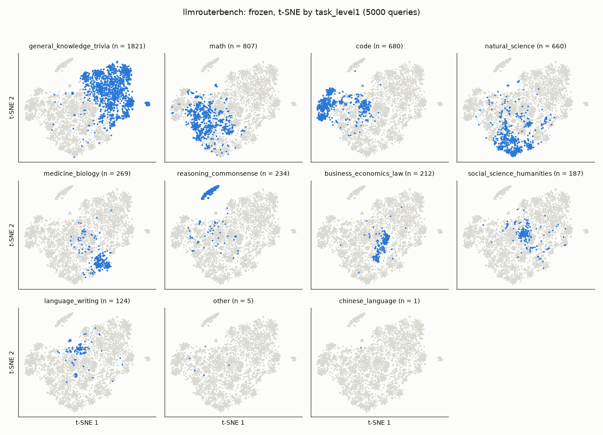

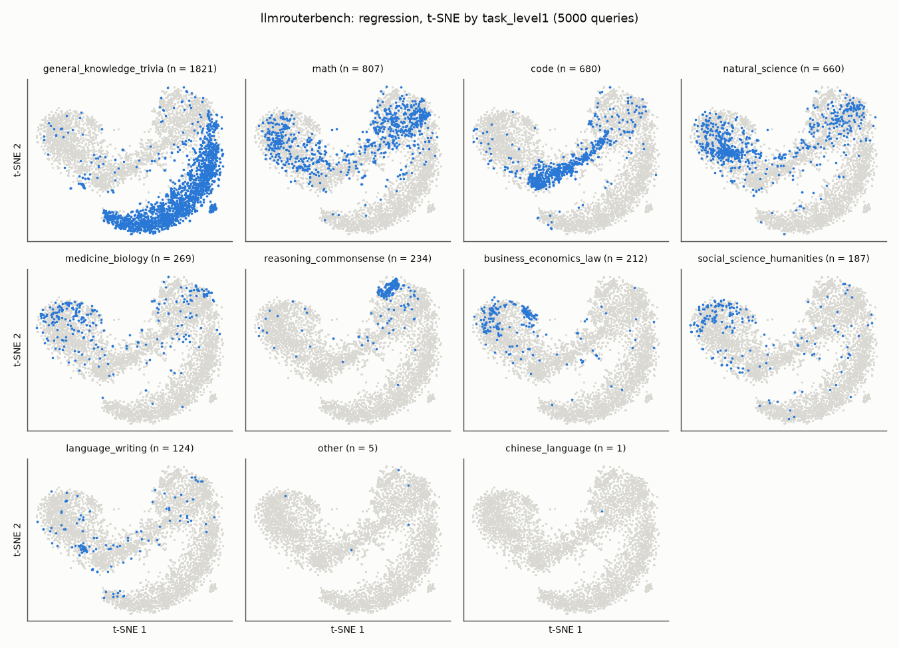

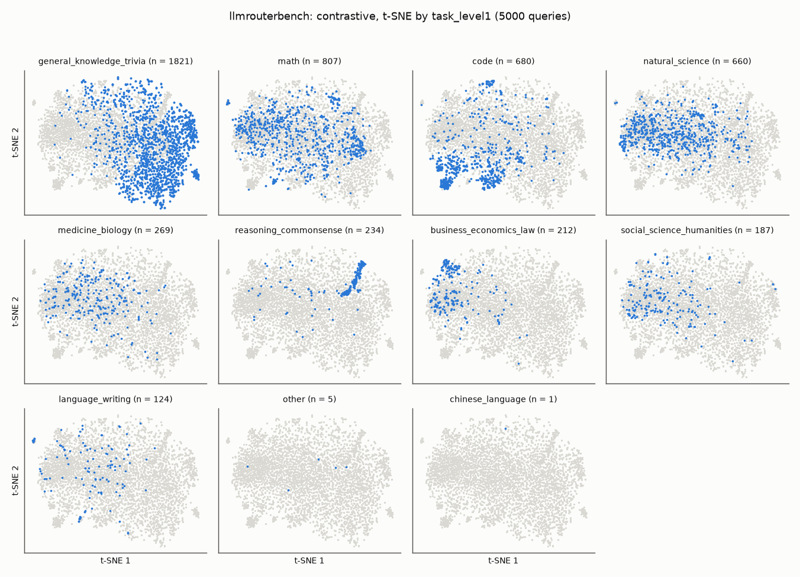

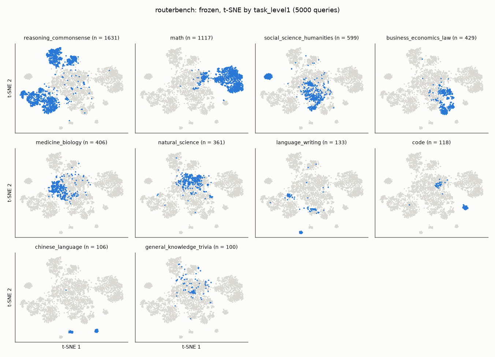

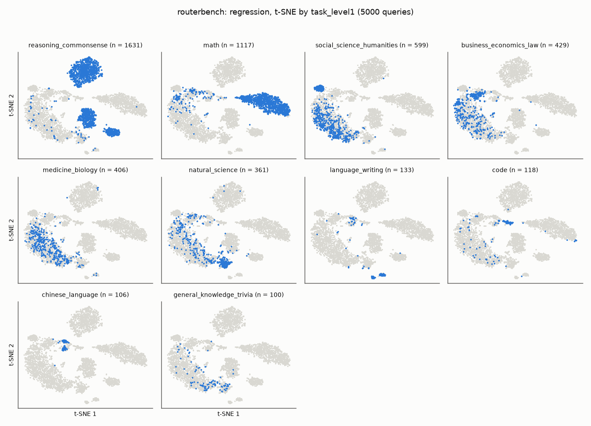

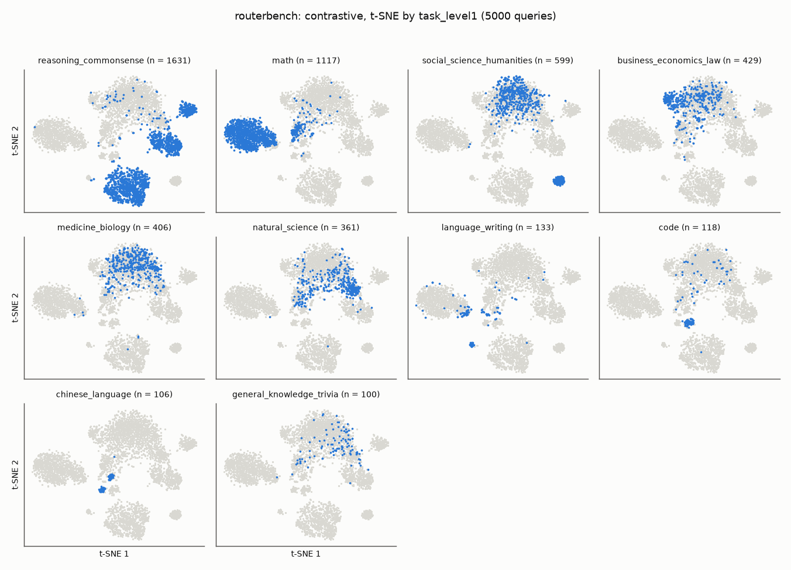

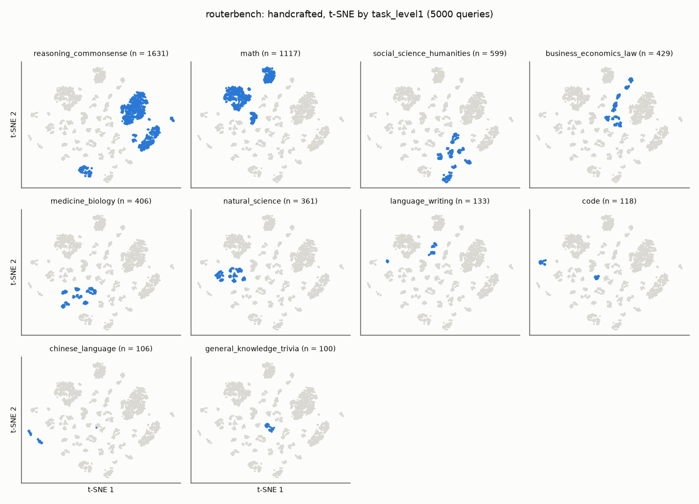

### 5.6 Task-type recovery, probes-to-target and sensitivity

Task-type recovery with the *theme* one-hot (Nikhilesh's grid): A(task_type) / A(learned), final pool.

| benchmark | learned objective | recovery | sd over splits |
|---|---|---|---|
| llmrouterbench | contrastive | 1.0164 | 0.0094 |
| llmrouterbench | regression | 0.9961 | 0.0030 |
| routerbench | contrastive | 0.9649 | 0.0063 |
| routerbench | regression | 0.9639 | 0.0055 |

Probes-to-target (90% of the seen A): 3,402 of 3,402 cases reach it within the tested budgets, 2,971 at one probe. The A-based target is uninformative here: the single best alone already has A ≥ 0.9·A_seen (0.955 on LLMRouterBench, 0.931 on RouterBench), so the recovery-based target in section 5.2 is the one to read.

Sensitivity (one factor at a time, every main run; paired absolute change of A from the reference run):

| benchmark | variant | 95th percentile |ΔA| | max |ΔA| |
|---|---|---|---|
| llmrouterbench | k10 | 0.0423 | 0.0926 |
| llmrouterbench | k100 | 0.0100 | 0.0724 |
| llmrouterbench | k20 | 0.0287 | 0.1442 |
| llmrouterbench | k200 | 0.0008 | 0.0174 |
| llmrouterbench | k400 | 0.0134 | 0.0764 |
| llmrouterbench | k5 | 0.0617 | 0.1228 |
| llmrouterbench | k50 | 0.0189 | 0.0941 |
| llmrouterbench | lambda_points100 | 0.0015 | 0.0107 |
| llmrouterbench | lambda_points1000 | 0.0005 | 0.0708 |
| llmrouterbench | lambda_range_narrow | 0.0011 | 0.0141 |
| llmrouterbench | lambda_range_wide | 0.0006 | 0.0044 |
| routerbench | k10 | 0.0822 | 0.3235 |
| routerbench | k100 | 0.0157 | 0.3121 |
| routerbench | k20 | 0.0633 | 0.3234 |
| routerbench | k200 | 0.0000 | 0.0347 |
| routerbench | k400 | 0.0095 | 0.1817 |
| routerbench | k5 | 0.1569 | 0.3122 |
| routerbench | k50 | 0.0610 | 0.3120 |
| routerbench | lambda_points100 | 0.0005 | 0.0085 |
| routerbench | lambda_points1000 | 0.0001 | 0.0021 |
| routerbench | lambda_range_narrow | 0.0020 | 0.0110 |
| routerbench | lambda_range_wide | 0.0001 | 0.0026 |

k matters (fixed k = 5 or 10 moves A by up to 0.1–0.3), the λ grid barely (95th percentile below 0.002).

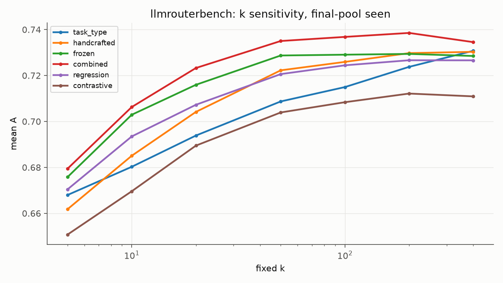

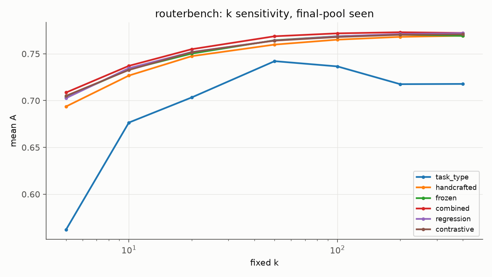

### 5.7 One k for the pool and the new model: how the neighbourhood size interacts with the probe budget

The harness uses one k for every model. A new model has labels on n probes only, so its estimate averages min(k, n) probes: with k ≥ n it is one constant for every query (the probe mean). The table fixes k and shows the unseen gain at two budgets on a few release instances (split 0, one training and probe seed; checkpoints from the unified run, nothing retrained). Cells with k ≥ n are marked †.

n = 50 probes:

| benchmark | representation | instance | k = 20 | k = 50 | k = 200 | k = 500 | k = 1000 |
|---|---|---|---|---|---|---|---|
| llmrouterbench | contrastive | 9 | -1.25% | -6.62% † | -7.96% † | -10.21% † | -9.72% † |
| llmrouterbench | contrastive | 10 | -5.13% | -11.74% † | -13.24% † | -15.32% † | -16.01% † |
| llmrouterbench | contrastive | 11 | -2.85% | -3.03% † | -1.82% † | -2.04% † | -1.99% † |
| llmrouterbench | frozen | 9 | +0.18% | +0.14% † | +1.61% † | +3.41% † | +4.18% † |
| llmrouterbench | frozen | 10 | +0.56% | +0.35% † | +2.27% † | +4.38% † | +4.51% † |
| llmrouterbench | frozen | 11 | +1.10% | +0.04% † | +0.79% † | +2.65% † | +2.98% † |
| llmrouterbench | handcrafted | 9 | -1.80% | -1.68% † | -0.47% † | +1.13% † | +3.05% † |
| llmrouterbench | handcrafted | 10 | -1.03% | -1.78% † | -0.22% † | +0.57% † | +3.49% † |
| llmrouterbench | handcrafted | 11 | -0.61% | -0.71% † | -0.03% † | +0.96% † | +1.94% † |
| llmrouterbench | regression | 9 | +0.89% | -2.56% † | -1.61% † | -3.32% † | -3.44% † |
| llmrouterbench | regression | 10 | +2.64% | -3.78% † | -2.65% † | -3.99% † | -3.97% † |
| llmrouterbench | regression | 11 | +1.82% | -0.34% † | -1.11% † | -0.81% † | -1.79% † |

n = 500 probes:

| benchmark | representation | instance | k = 20 | k = 50 | k = 200 | k = 500 | k = 1000 |
|---|---|---|---|---|---|---|---|
| llmrouterbench | contrastive | 9 | -0.23% | +0.67% | +0.92% | -9.23% † | -9.17% † |
| llmrouterbench | contrastive | 10 | -0.37% | -0.73% | -3.74% | -14.33% † | -15.20% † |
| llmrouterbench | contrastive | 11 | -0.85% | +0.77% | +0.36% | -2.17% † | -1.96% † |
| llmrouterbench | frozen | 9 | +1.62% | +2.41% | +3.35% | +4.12% † | +4.51% † |
| llmrouterbench | frozen | 10 | +1.55% | +2.48% | +4.12% | +4.71% † | +4.59% † |
| llmrouterbench | frozen | 11 | +2.00% | +3.37% | +4.75% | +4.93% † | +4.60% † |
| llmrouterbench | handcrafted | 9 | +0.85% | +1.44% | +1.38% | +2.01% † | +3.82% † |
| llmrouterbench | handcrafted | 10 | +0.43% | +1.42% | +1.87% | +1.79% † | +4.28% † |
| llmrouterbench | handcrafted | 11 | +0.14% | +2.14% | +3.31% | +4.51% † | +5.07% † |
| llmrouterbench | regression | 9 | +1.25% | +2.65% | +3.60% | -2.66% † | -2.89% † |
| llmrouterbench | regression | 10 | +2.77% | +2.67% | +4.18% | -3.51% † | -3.51% † |
| llmrouterbench | regression | 11 | +1.82% | +4.10% | +4.24% | -0.22% † | -0.97% † |

n = 50 probes:

| benchmark | representation | instance | k = 20 | k = 50 | k = 200 | k = 500 | k = 1000 |
|---|---|---|---|---|---|---|---|
| routerbench | contrastive | 7 | -1.24% | +0.47% † | +1.62% † | +1.60% † | +1.60% † |
| routerbench | contrastive | 8 | +3.96% | +5.50% † | +6.53% † | +6.51% † | +6.56% † |
| routerbench | frozen | 7 | +1.68% | +1.19% † | +2.36% † | +2.56% † | +2.87% † |
| routerbench | frozen | 8 | +4.34% | +5.64% † | +6.53% † | +6.46% † | +6.37% † |
| routerbench | handcrafted | 7 | +0.58% | +0.69% † | +1.51% † | +1.83% † | +2.22% † |
| routerbench | handcrafted | 8 | +4.80% | +6.17% † | +6.61% † | +6.69% † | +6.60% † |
| routerbench | regression | 7 | -0.61% | -0.19% † | +0.50% † | +0.91% † | +1.06% † |
| routerbench | regression | 8 | +3.81% | +5.52% † | +6.58% † | +6.72% † | +6.75% † |

n = 500 probes:

| benchmark | representation | instance | k = 20 | k = 50 | k = 200 | k = 500 | k = 1000 |
|---|---|---|---|---|---|---|---|
| routerbench | contrastive | 7 | +2.36% | +3.62% | +2.29% | +1.83% † | +1.67% † |
| routerbench | contrastive | 8 | +3.93% | +5.58% | +5.75% | +5.79% † | +5.68% † |
| routerbench | frozen | 7 | +3.19% | +4.17% | +4.65% | +2.67% † | +3.04% † |
| routerbench | frozen | 8 | +4.11% | +5.40% | +6.06% | +6.18% † | +6.29% † |
| routerbench | handcrafted | 7 | +3.95% | +4.34% | +3.05% | +2.04% † | +2.31% † |
| routerbench | handcrafted | 8 | +4.96% | +5.85% | +5.93% | +6.20% † | +6.43% † |
| routerbench | regression | 7 | +3.64% | +4.57% | +1.59% | +0.86% † | +1.06% † |
| routerbench | regression | 8 | +4.06% | +5.79% | +6.10% | +6.01% † | +6.07% † |

## 6. Observations

1. **Every representation beats the single best model in the seen setting**: from +1.95% (contrastive) to +4.86% on LLMRouterBench and from +2.62% (Level-1 label alone) to +8.02% on RouterBench (unified run, section 5.3). Per-run bootstrap half-widths are about ±1.3 points on LLMRouterBench and ±0.8 on RouterBench, so the gains are real but the top of each table is a cluster: on LLMRouterBench no paired interval separates `handcrafted_nik`, `task_type_theme`, `handcrafted`, `regression_hc`, `combined` or `stats` from `handcrafted` (section 5.4).
2. **Where the learned embeddings help, it is with the handcrafted block as input, and only on RouterBench.** `regression_hc` (+8.02%) and `contrastive_hc` (+7.85%) beat `handcrafted` (+7.41%) by 0.5–0.6 points with the paired interval excluding zero on all three splits; plain `regression` (+7.82%) is a smaller, unconfirmed gain. On LLMRouterBench the learned embeddings are at or below the frozen input and the handcrafted block (+4.17% regression, +1.95% contrastive, the latter significantly worse on every split). Task-type recovery A(label)/A(learned) is 0.95–1.03 for every level: a one-hot label routes about as well as either learned embedding in the seen setting.
3. **The LLM task hierarchy does not beat the benchmark's own theme as a one-hot, and adds little inside the handcrafted block.** Theme one-hot +4.77% / +3.85% against Level 1 + 2 +4.21% / +3.43%; our `handcrafted` (L1 + L2 + 15 statistics) +4.73% / +7.41% against Nikhilesh's (theme + 3 lengths) +4.86% / +7.17%: both pairs are within one split sd. The query statistics carry most of the signal (`stats` alone +4.42% / +7.07%); on RouterBench, where the themes are datasets, any label alone is 3.5–4.8 points behind the statistics because the 9.8k MMLU training queries span every domain and the label cannot separate easy from hard inside a dataset.
4. **With a new model, the representations that do not depend on the model scores hold up; the learned ones collapse, and section 5.7 shows why.** At 500 probes on LLMRouterBench: `stats` +2.28%, `combined` +2.22%, `handcrafted` +2.10%, `frozen` +2.07% (recovery 0.50–0.60 of the seen gain), against `regression` -0.60% and `contrastive` -2.84%: worse than the single best. The cause is not the representation itself but the shared k: every statistics- or sentence-based representation selects k = 1000 on the validation split, and with k ≥ n probes the new model's estimate is one constant. In a space organized by quality, the pool models' estimates are low exactly on the hard queries, so the constant new-model estimate wins there and the router sends the hard queries to the expensive new model, which fails on them too. With k = 200 < 500 probes (Nikhilesh's grid) `regression` is as good as `frozen` on the same instances (section 5.7, +4.2% vs +4.1% and +3.6% vs +3.4%), not better; at 50 probes the same collapse appears for k = 200 in both grids, and at k = 20 < 50 `regression` is ahead of `frozen` (+0.9 to +2.6% against +0.2 to +1.1%). On RouterBench the effect is absent (every representation keeps +2–7% at any k): it needs a quality-organized space and a new model that is strong on the hard queries, as the 2025 flagships of LLMRouterBench are. So the answer to "are handcrafted features best on seen models and frozen embeddings best on new ones" is: in the seen setting they tie on LLMRouterBench and the learned-with-handcrafted MLP leads on RouterBench; with a new model the frozen and handcrafted representations are robust and the learned ones are only as good as the harness lets the new model's estimate be local. The fix is a harness change (a separate, probe-bounded k for the new model), noted in HARNESS_NOTES.md.
5. **The learned embeddings are not "just task type"; they carry less of it than their frozen input.** Share of a query's 10 nearest neighbours with the same Level-1 domain (section 5.5): frozen 81% / 87%, regression 66% / 78%, contrastive 54% / 78% (majority class 37% / 32%), against 100% for the label one-hots and 99.8% for `handcrafted`. Training on quality profiles moves queries by how the models behave on them, not by topic: the t-SNE of `frozen` shows topic clusters (code, math, trivia), that of `regression` a quality-ordered band with every domain spread along it. The `_hc` variants carry more task type (76–89%) because the handcrafted block is in their input, which is where their RouterBench gain comes from.
6. **k is the sensitive hyperparameter, not λ.** Fixed k = 5 or 10 changes A by up to 0.1 (LLMRouterBench) and 0.3 (RouterBench); the λ grid changes it by less than 0.002 at the 95th percentile. The one-standard-error rule selects the top of the grid for every statistics- or sentence-based representation (1000 here, 200 in Nikhilesh's grid): the validation curve is flat, the router is a wide local average, and the cap of the grid decides the unseen numbers through observation 4. The seen gains move little between the two grids (frozen +4.9% at k = 200, +4.1% at k = 1000 on LLMRouterBench).

## 7. What is pending and how to reproduce

Done: Nikhilesh's grid (`results_summary/`), the handcrafted runs (`alexandros-handcrafted/RESULTS.md`), the task labels (`preproc/data/<benchmark>/task_labels.parquet`), the unified comparison (`results_compare/`, SLURM job 1159197, 6 h 42 min on one Vista GH200 node), its paired tests, views and k check (`analysis_compare/`).

Open:

1. A like-for-like rerun with Nikhilesh's k grid, so that the unseen numbers of all representations are on his protocol: `OUT=results_compare_k200 ANALYSIS=alexandros-handcrafted/analysis_compare_k200 EXTRA="--k-grid 5 10 20 50 100 200" sbatch alexandros-handcrafted/sbatch/compare_vista.slurm` (the MLP checkpoints and sentence vectors are cached, so it is faster than the first run).
2. The harness change that removes the artefact of observation 4: a probe-bounded k for the new model (e.g. k_new = min(k, n/2)), or k_new tuned on the probes. Proposed to Michal in HARNESS_NOTES.md.
3. Rebuild: `python alexandros-handcrafted/build_report.py` then `python alexandros-handcrafted/report_html.py --out <file>`.
