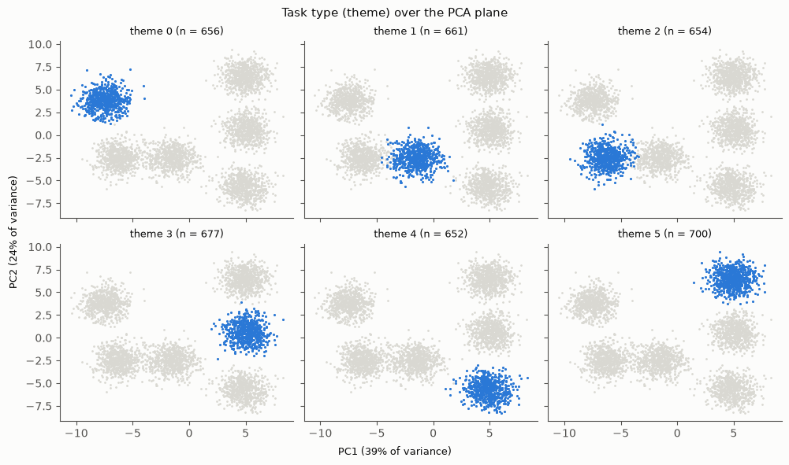
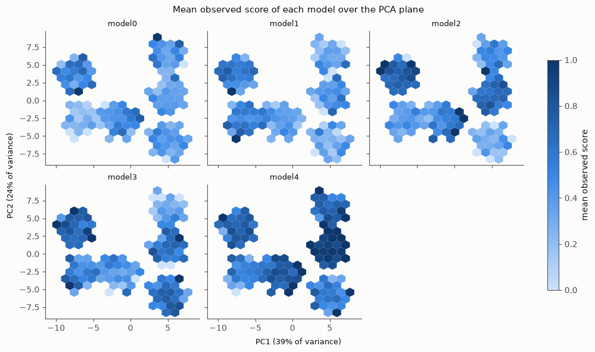
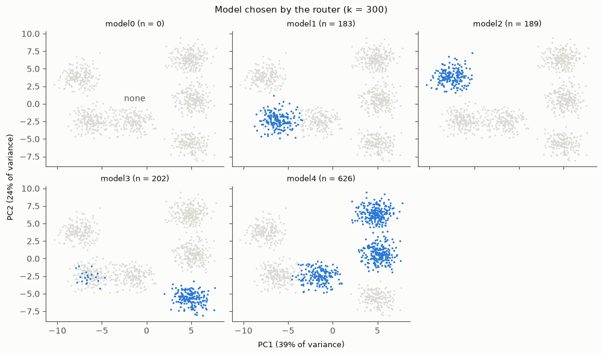

# Router and evaluation harness

Michal's component (paper §7.2). You give it an embedding of queries, it tells you how good a kNN router built on that embedding is.

**How it works.** For a query `x`, each model's quality is estimated by averaging that model's scores over the `k` nearest labeled queries (Euclidean distance in your embedding). The router picks the model maximizing `q̂ − λ·cost`. Sweeping λ gives a cost-quality curve, and we compare the area under it with the area of the **single best fixed model**.

### The estimator and the router

From the paper (Eqs. 1 and 2). The router picks, for a query $x$, the model with the best estimated quality minus the cost weighted by $\lambda$:

$$
m_t(x) \;=\; \arg\max_{m \in \mathcal{M}_t} \; \hat{q}_m(x) \;-\; \lambda \, c_t(m)
$$

and the quality estimate is a kNN average over labeled neighbors in embedding space:

$$
\hat{q}_m(x) \;=\; \frac{1}{\left| N_k^{(m)}(x) \right|} \sum_{i \in N_k^{(m)}(x)} s_m(x_i)
$$

where
- $\phi(x) \in \mathbb{R}^d$ is the query embedding (what you provide through `fit`) and $\mathcal{M}_t$ is the candidate pool at epoch $t$;
- $c_t(m)$ is the **mean** per-query cost of model $m$ at epoch $t$, and $\lambda > 0$ is the cost weight that sets the quality-cost trade-off;
- $N_k^{(m)}(x)$ are the $k$ nearest queries to $x$ under $\phi$ (Euclidean distance $\lVert \phi(x) - \phi(x') \rVert_2$) among those for which model $m$ has an observed score $s_m(x_i) \in [0, 1]$.

In the code these are `knn_estimate` (Eq. 2) and `route` (Eq. 1). Details that follow from the equations: each model averages **its own** scores, models labeled on the same queries share the neighbors, and a model with fewer than $k$ labels (a new model with few probes) uses $\min(k, n)$ neighbors, which is why the denominator is $|N_k^{(m)}(x)|$. Ties in Eq. 1 go to the cheaper model.

**Main number: the gain over the single best.** `A` (area relative to the oracle) is reported in parentheses as the secondary number.

All design decisions, with their reasons, are in [`decision.md`](decision.md). The dated history is in [`worklog.md`](worklog.md).

## Files

| File | What |
|---|---|
| `router.py` | the kNN estimator, routing, `evaluate`, `Results` (saving), bootstrap interval, `k` tuning |
| `plots.py` | every figure, in one style |
| `test_router.py` | 41 tests on synthetic data (also holds the synthetic data generator `make_data`) |
| `walkthrough.ipynb` | a guided tour with plots on the synthetic data |
| `figures/` | the example figures shown below (from section 9 of the notebook) |

## Entry points

There is no command line script. You use Python:

- `evaluate(data, fit, ...)`: one evaluation, returns a dict of metrics.
- `Results(data, benchmark).run(name, fit, ...)`: the same, and saves everything (see "Saved results").
- `plots.*`: figures from arrays or `evaluate` results.

## Setup

Python 3.10+ and numpy 2.0+ (`np.trapezoid` is used).

```
pip install numpy scikit-learn matplotlib pytest pandas pyarrow    # pandas, pyarrow: preproc/data.py
pip install ipykernel nbclient        # only for the notebook
```

Run the tests from this folder (about 5 seconds):

```
python -m pytest -q
```

## Try it now on synthetic data

```python
from test_router import make_data
from router import evaluate

data, fit = make_data()                     # 4000 queries, 5 models, 8-dimensional embedding
res = evaluate(data, fit, tune_k=True)
print(res["gain"], res["gain_ci"], res["A"], res["k"])
```

Open `walkthrough.ipynb` for the whole tour (kernel with these packages, importing `test_router` needs pytest).

## Plug in your embedding: the `fit` contract

`evaluate` takes a **factory** `fit(train_models) -> embed`, where `embed(list[str]) -> np.ndarray` of shape `(n_queries, d)`, row `i` for query `i`. It is a factory so that a learned embedding can be retrained **without the held-out model** in the unseen setting: `evaluate` calls `fit` once per run, with the pool minus the held-out model.

Frozen embedding (handcrafted features, sentence encoders):

```python
def fit(train_models):      # the pool does not matter for a frozen embedding
    return embed
```

Learned embedding:

```python
def fit(train_models):
    phi = train_phi(data, train_models)   # only the models in train_models, only the queries in data.train
    return phi.embed
```

Rules for an embedding:
- **Distance is Euclidean, so the embedding owns its scaling.** L2-normalize sentence embeddings. Standardize handcrafted features, otherwise one large-scale feature dominates every distance (the notebook shows this with the explained-variance plot).
- **Never touch `data.val`**, early stopping included. It is reserved for tuning `k`. Carve your early-stopping set out of `data.train`.
- Train only on the pool you are given. In the unseen setting the new model must not influence the embedding.

## The data (`Data` in `router.py`)

`Data` is defined in `preproc/data.py` (Arman) and re-exported by `router.py`. Load it with `load_data` (see `preproc/README.md`).

| Field | |
|---|---|
| `queries` | `list[str]` |
| `models` | `list[str]`, the pool |
| `S` | `(n_queries, n_models)` observed scores in [0, 1], every model on every query |
| `cost` | `(n_models,)` **mean** per-query cost of each model at the evaluated epoch (not per-query cost) |
| `train`, `val`, `test` | index arrays into `queries` |
| `theme` | optional, task type of each query (used for plots) |
| `split_seed` | which split this is (default 0), written to the results |

`load_data` adds `benchmark`, `query_ids`, `subtask`, `epoch` and `new_model` (the unseen model of an instance, pass it to `evaluate(new_model=...)`). The harness does not use them.

## Running experiments

Seen-model setting, and unseen-model setting (`new_model` is held out, labeled only on `n_probes` probe queries):

```python
res = evaluate(data, fit, tune_k=True)                                           # seen
res = evaluate(data, fit, new_model="GLM-4.6", n_probes=50, seed=0, tune_k=True)  # unseen
```

Useful arguments: `k` (default 10, ignored with `tune_k=True`), `tune_k` (one-standard-error rule on `data.val`, recommended, prints a warning if the best `k` is at the edge of `k_grid`), `n_boot` (bootstrap resamples, `0` skips the interval), `n_lambdas` (default 500), `seed` (probe draw).

To run many settings and keep everything, use `Results`. **Run the seen setting first** so that unseen runs of the same embedding name get their `recovery`:

```python
from router import Results

out = Results(data, "llmrouterbench")      # new folder results/<timestamp>/
kw = dict(tune_k=True)
out.run("handcrafted", fit, **kw)
for new_model in held_out_models:
    for n in (1, 2, 5, 10, 20, 50, 100, 500):
        for seed in range(5):
            out.run("handcrafted", fit, new_model=new_model, n_probes=n, seed=seed, **kw)
```

A learned embedding is retrained in every unseen run, so that loop is expensive for it. Use fewer seeds where training is slow.

For several splits, repeat it per split (each `Data` has its own `split_seed`, and `Results` writes it to the table and the folder name):

```python
for split_seed in range(3):
    data = load_data("llmrouterbench", split_seed=split_seed)    # from preproc.data import load_data
    out = Results(data, "llmrouterbench")
    ...                                                         # the loop above
```

## What comes back

`evaluate` returns a dict:

| Key | Meaning |
|---|---|
| `gain` | **main number**: area gain over the full-information single best, `area_router / area_single_best − 1` |
| `gain_ci` | 95% bootstrap interval of `gain` over the test queries (`None` if `n_boot=0`) |
| `gain_abs` | the same difference as a mean score averaged over the price range (easier to interpret) |
| `A`, `A_single_best` | area relative to the oracle, for the router and for the single best (secondary) |
| `gain_same_probes` | unseen only: gain over the single best that knows the new model only from the same probes |
| `k` | the `k` used (the tuned one with `tune_k=True`) |
| `curves`, `lambdas`, `Q_hat`, `q_mean`, `probes`, ... | the raw material for plots and for recomputing |

For an unseen run, report three numbers: `gain` (main, over a baseline that does not change with `n_probes`), `gain_same_probes`, and `recovery`, the unseen gain divided by the seen-model gain (`router.recovery(unseen, seen)`, or the `recovery` column of `Results`).

How to report: the mean over seeds, the spread across seeds, and the bootstrap interval, kept separate.

## Saved results

`Results` (one per `Data`, i.e. per split) writes a new folder `results/YYYY-MM-DD_HH-MM-SS_split<split_seed>/`, ignored by git:

```
results.csv      one row per run: benchmark, embedding, new_model, n_probes, seed, split_seed, tune_k, k, n_lambdas,
                 gain, gain_abs, gain_same_probes, recovery, gain_ci_low, gain_ci_high, A, A_single_best
runs/NNNN.npz    per run: the λ grid, the cost-quality curves, the test q̂, mean qualities and the probes
split.npz        the train, val and test indices
meta.json        time, git commit (-dirty if uncommitted changes), model names, costs
```

With these files the routing, the area and the gain can be recomputed without refitting the embedding or rerunning the kNN.

## Plots (`plots.py`)

`plot_curves`, `plot_curves_by_k`, `plot_gain_vs_probes`, and the PCA views: `pca_project`, `plot_pca_groups` (task type, chosen model; pass `groups` to show every group in a fixed order, empty ones included), `plot_pca_quality`, `plot_explained_variance`, `plot_probes`, `plot_neighbors`. Each takes arrays or `evaluate` results and returns the figure. Use them so all figures share one style.

## Example plots

All three come from section 9 of `walkthrough.ipynb` (synthetic data, a frozen 8-dimensional embedding). The PCA axes are fitted on the training queries, and the axis labels give the share of variance each axis holds.

```python
import plots
from router import evaluate, route

E = fit(data.models)(data.queries)
Z, ratio = plots.pca_project(E, fit_idx=data.train)

plots.plot_pca_groups(Z, ratio, data.theme, "Task type (theme) over the PCA plane")
plots.plot_pca_quality(Z[data.train], ratio, data.S[data.train], data.models)

res = evaluate(data, fit, tune_k=True)
picks = route(res["Q_hat"], data.cost, 0.1 / (data.cost.max() - data.cost.min()))  # λ · (cost range) = 0.1
plots.plot_pca_groups(Z[data.test], ratio, picks, "Model chosen by the router",
                      names=dict(enumerate(data.models)), groups=range(len(data.models)))  # every model, in order
```

**1. Task type over the PCA plane.** One panel per theme, the theme in blue over all queries in gray. The six themes form six well-separated clusters. That is by construction in the synthetic data; real embeddings will overlap more, and how much task type alone captures is what RQ1a asks.



**2. What each model does.** One panel per model, in the original order of the models: the observed score averaged in hexagonal bins of the plane, on a shared 0 to 1 scale. A model's score is roughly constant within a cluster, and the pattern across clusters differs from model to model, so which model is best depends on where the query sits. This is the structure the kNN average exploits.



**3. The routing map.** The model the router (tuned `k`) sends each test query to, at one λ. The panels follow the original order of the models, and a model that is never chosen keeps its (empty) panel: here `model0`. Almost every cluster goes to a single model and different clusters go to different models. A single best model would send every query to the same one.



## Things to keep in mind

- **One split is one sample.** The bootstrap interval measures test-set noise, seeds measure probe and training randomness, and only running several split seeds (each its own `Data`, with `split_seed` set) measures re-splitting variance. Report the three kinds of spread separately.
- **Held-out models are separate experiments**, not repeats. Report each release event; a mean across them is only a summary.
- **Compare gains only within one benchmark and release epoch.** The cost range depends on the model set.
- **Routing ties go to the cheaper model**, so the order of `models` does not matter.
- The router can legitimately ignore a new model that is much worse and more expensive. Then nothing changes with the probe budget.

## Status

Done: the router, the metrics, the bootstrap interval, `k` tuning, saved results, the plots and the tests.

Still stand-ins or open:
- `Data`, the mean costs and the splits come from Arman's `preproc/data.py` (`load_data`). Nothing else is needed from him.
- Probes come from `preproc.data.sample_probes` (a seeded permutation of the training queries, first `n_probes`), so a smaller budget's probes are contained in a larger one's and every embedding gets the same probes. It also has a theme-stratified option, not used by `evaluate` yet.
- Probes-to-target and a sensitivity check on λ and `k` are optional and not implemented.
- The `evaluate` interface and the results format still need sign-off from everyone.
